<div align="center">

# 6-Action Recognition · From Reusing a Trained Model to an Async Web Service

</div>

<p align="center">
         <br>
        <br>
    
</p>

<p align="center"><a href="README.md">한국어</a> | <b>English</b></p>

I took the **Random Forest** trained on Day 6 (30 steps × 38 features = 1,140 inputs) **without retraining** and deployed it as a service: video upload or an 8-second phone IP Webcam capture → YOLO11n-pose + ByteTrack → **one of 6 actions per person**, running as 5 Docker Compose services (Django · Celery · FastAPI · PostgreSQL · Redis).
Because the model was trained on a single person (S01), the original 0.55 confidence rule confirmed **0 predictions** for a new person (S03). I added a rule that also checks the gap between the top-1 and top-2 probabilities, chose its thresholds on the validation person (S02) only, and confirmed **2 predictions on S03, both correct · 0 / 6 confirmed on untrained actions**.

## At a Glance

<p align="center">
  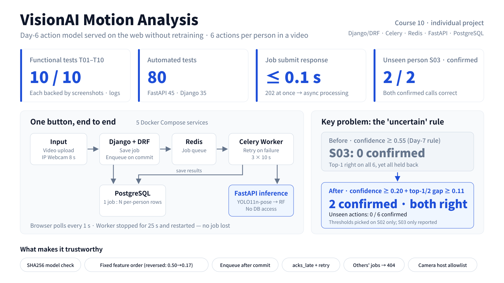
</p>

<table>
  <tr>
    <th width="10%"></th>
    <th width="45%">① AI inference · model reuse</th>
    <th width="45%">② Web service · async processing</th>
  </tr>
  <tr>
    <td align="center"><b>What I did</b></td>
    <td>Cross-checked the 3 model files · reused the exact training-time feature code · compared window strategies · redesigned the 'uncertain' rule</td>
    <td>Accounts · permissions (DRF) · enqueue to Celery after commit · retry on failure · IP Webcam allowlist · Admin · dashboard</td>
  </tr>
  <tr>
    <td align="center"><b>Key numbers</b></td>
    <td>New person S03 Top-1 <b>5 / 6</b> · confirmed <b>2 / 2</b> correct · untrained actions confirmed <b>0 / 6</b> · reversing the feature order drops accuracy <b>0.500 → 0.167</b></td>
    <td>Submit <b>within 0.1 s (202)</b> · <b>no job lost</b> when the Worker was stopped for 25 s · T01–T10 <b>10 / 10</b> · automated tests <b>80</b></td>
  </tr>
  <tr>
    <td align="center"><b>Docs</b> (Korean)</td>
    <td><a href="reports/evidence/holdout/holdout_eval.md">Held-out evaluation</a> · <a href="docs/design_qa.md">Design Q&amp;A</a></td>
    <td><a href="docs/api.md">API</a> · <a href="docs/verification.md">Step-by-step verification</a> · <a href="docs/troubleshooting.md">Troubleshooting</a></td>
  </tr>
  <tr>
    <td align="center"><b>Screens</b></td>
    <td align="center" valign="top">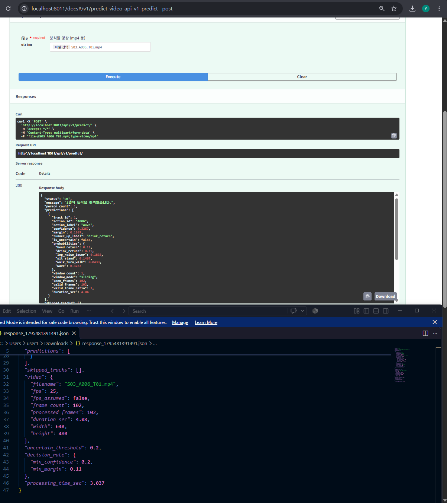<br>FastAPI standalone inference (Swagger)</td>
    <td align="center" valign="top">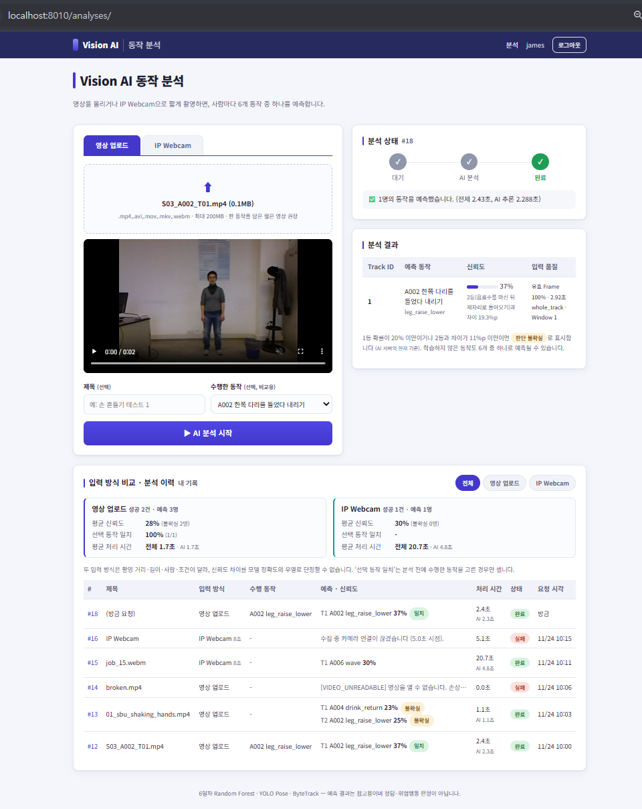<br>Per-person result · confidence · top-1/2 gap</td>
  </tr>
</table>

---

## 1. Project Overview

A signed-in user **uploads a short video** or **records 5–10 seconds with a phone IP Webcam**, and the service predicts one of 6 actions and its confidence **for each person** in the video. A Celery Worker runs the analysis in the background, so the user gets a job ID immediately and watches its progress. Results are stored in PostgreSQL, and staff can review all records and compare input types in Django Admin and the dashboard.

| A001 `bend_return` | A002 `leg_raise_lower` | A003 `walk_turn_walk` | A004 `drink_return` | A005 `sit_stand` | A006 `wave` |
|---|---|---|---|---|---|
| Bend and straighten | Raise and lower one leg | Walk, turn, walk | Drink, then return | Sit down and stand up | Wave a hand |

> The Day-6 model was trained on **6 videos of one person (S01)**, so a prediction is **not ground truth or a safety judgment.** Every result shows confidence · **the gap to the 2nd class** · per-class probabilities · input quality, and is marked **uncertain** when the top-1 probability is low or close to the 2nd. The thresholds were chosen only on an untrained person (S02) → [7. Held-out check](#model-reuse-check--unseen-person-held-out)

---

## 2. How to Run

**① Prepare the models** — `*.joblib` and `*.pt` are excluded from Git. Copy them from the original practice repo into `ai_service/models/`.

| File | Source |
|---|---|
| `rf_action_baseline.joblib` | `subject10_pose_action/artifacts/day06/` (saved by `scripts/35_train_rf_baseline.py`) |
| `yolo11n-pose.pt` | `subject10_pose_action/` |
| `rf_feature_columns.json`, `rf_training_info.json`, `SHA256SUMS.txt` | included in this repo |

`joblib.load()` runs pickle, so the AI server opens **only files whose hash matches `SHA256SUMS.txt`**. A joblib from a different run is rejected at startup.

```bash
cd ai_service
python -m services.model_loader      # T01: cross-check 3 files + SHA256 → [T01 PASS] · SHA256 verified: True
```

**② Run**

```bash
cp .env.example .env                                           # edit POSTGRES_PASSWORD · DJANGO_SECRET_KEY · ALLOWED_CAMERA_HOSTS
docker compose up --build -d                                   # start 5 services (about 1 min until fastapi is healthy)
docker compose exec django python manage.py migrate            # apply migrations (also runs automatically on django start)
docker compose exec django python manage.py createsuperuser    # create an admin account
docker compose ps                                              # check all 5 are Up
```

**③ Open** (URL rules follow the recommended design in chapter 5 of the development guide)

| Target | URL |
|---|---|
| Sign up · log in | http://localhost:8000/accounts/signup/ · http://localhost:8000/accounts/login/ |
| User analysis page | http://localhost:8000/analyses/ |
| Analysis API (DRF) | `POST`·`GET` http://localhost:8000/api/v1/analyses/ · `GET /api/v1/analyses/{id}/` · `GET /api/v1/analyses/{id}/status/` |
| Staff dashboard · Django Admin | http://localhost:8000/dashboard/ · http://localhost:8000/admin/ (dashboard link at the top of Admin) |
| FastAPI docs · inference | http://localhost:8001/docs · `POST /api/v1/predict/` (same function as the assignment contract `POST /predict/video`) |

**④ End-to-end check** — log in → upload → 202 + job ID → status polling → PostgreSQL query, all with curl in one run, with a saved log.

```bash
bash scripts/smoke_e2e.sh ~/ai_vision/subject10_pose_action/data/day05/videos/S03/S03_A006_T01.mp4
```

> If a port is already in use, change only `DJANGO_HOST_PORT` · `FASTAPI_HOST_PORT` in `.env` (the demo environment of this repo uses 8010 · 8011). For IP Webcam, put the phone and PC on the same Wi-Fi and register the app's `IP:port` in `ALLOWED_CAMERA_HOSTS`.
> Running without Docker · running tests → [`docs/development.md`](docs/development.md)

---

## 3. Architecture

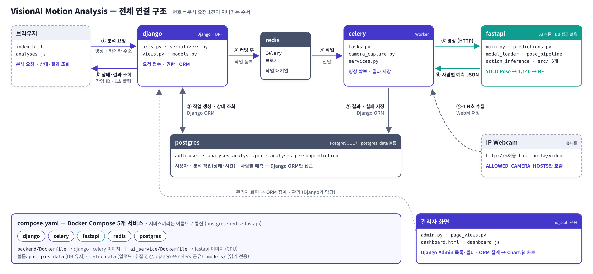

| Service | Responsibility | Does not |
|---|---|---|
| **django** (Django + DRF) | accounts · accepting analysis requests · permissions · queries · admin pages · ORM | AI inference |
| **celery** (Celery Worker) | get the video (upload / camera capture) → call FastAPI → **save results with the Django ORM** | render pages |
| **fastapi** | YOLO Pose · ByteTrack → 1,140 features → Random Forest → JSON | **touch the DB** |
| **redis** | Celery job queue | store permanent data |
| **postgres** | permanent storage of users · analysis jobs · per-person predictions | — |

---

## 4. Database Design (ERD)

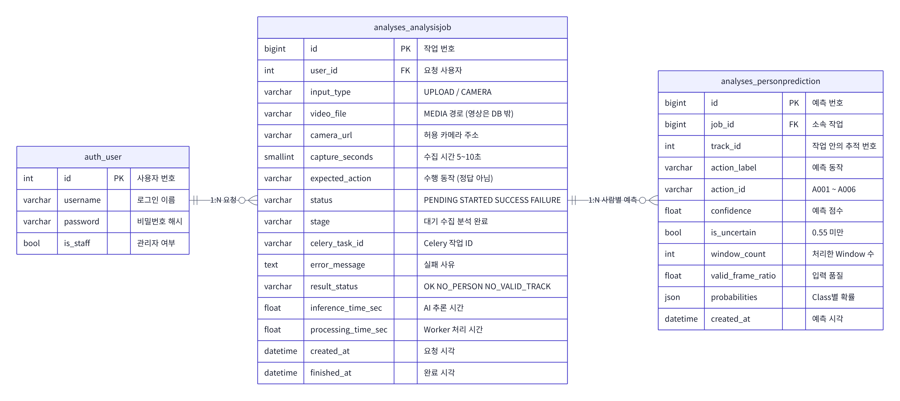

| Table | What it stores | Defined in |
|---|---|---|
| `auth_user` | login accounts (built into Django) | — |
| `analyses_analysisjob` | one analysis request with its status · error · processing time (video in MEDIA, only its path in the DB) | `backend/analyses/models.py` → `AnalysisJob` |
| `analyses_personprediction` | one prediction per person in the video. Two people → 2 predictions for 1 job (`track_id` is the number inside the job) | `backend/analyses/models.py` → `PersonPrediction` |

---

## 5. How the "AI Analysis" Button Works

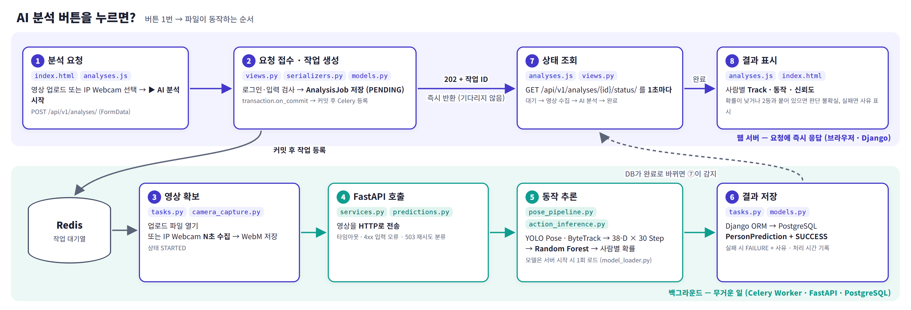

Django saves the job to the DB, enqueues it to Celery **after the transaction commits**, and **returns the job ID right away (202)**. The heavy work — getting the video, inference, saving — runs in the Worker in the background, and the browser polls the status with the job ID every second. The user never holds a request open while inference runs.

---

## 6. Model and Input Format

| Item | Details |
|---|---|
| Action classifier | `rf_action_baseline.joblib` — Day-6 RandomForestClassifier, **no retraining** · 3 files cross-checked at startup |
| Model input | 1,140 = **30 steps × 38 features** (17 joints × normalized x·y = 34 + elbow · knee angles 4) |
| Pose · tracking | `yolo11n-pose.pt` + ByteTrack, reusing the 5 original `src/` files unchanged |
| Uploaded video | `.mp4 .avi .mov .mkv .webm`, up to 200 MB · 60 s |
| IP Webcam | allowlisted cameras only, **5–10 s (8 s by default)** capture → saved as 30 fps · 640 px WebM → same inference as uploads |
| Window strategy | `sliding`: average of 5-second window probabilities — chosen from 4 strategies (`auto` · `whole_track` · `sliding` · `hybrid`) on the S02 held-out set (`ai_service/project.json`) |
| Uncertain | `confidence < 0.20` **or** `top-1 − top-2 < 0.11` (`decision` in `project.json`, chosen on S02 + untrained actions) |
| FastAPI I/O | `POST /api/v1/predict/` = `POST /predict/video` (video file) → per person `track_id` · `action_id` · `confidence` · `margin` (gap to 2nd) · probabilities · input quality + the decision rule applied · processing time |

> Response format and error codes → [`docs/api.md`](docs/api.md)

---

## 7. Results and Verification

> Every screen was captured on the 5 Docker Compose services after applying the decision rule (conf ≥ 0.20 · top-1/2 gap ≥ 0.11). Click an image to open it at full size.
> Whether a prediction is uncertain is recorded **with the rule in effect when it was saved**. Jobs from 11/23 in the dashboard · Admin were judged with the old rule (0.55), so their 'uncertain' share looks high.

| Normal analysis | Error · failure |
|---|---|
| <a href="reports/evidence/screenshots/T02_upload_result.png"></a> | <a href="reports/evidence/screenshots/T09_broken_file.png">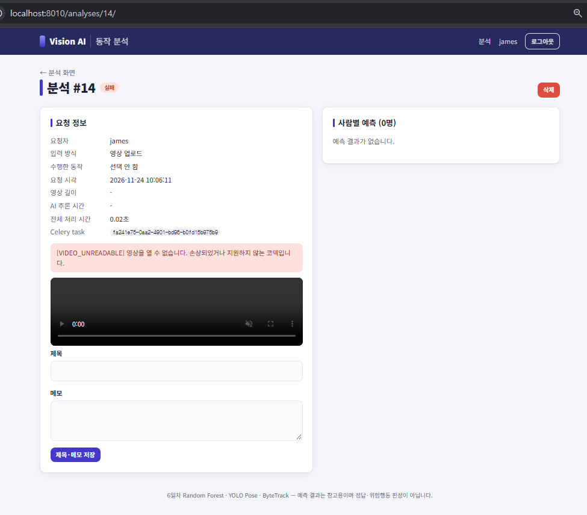</a> |
| Uploaded `S03_A002_T01.mp4` from an untrained person → **A002 leg_raise_lower confirmed** (gap to 2nd above the threshold) | Uploaded a text file as `broken.mp4` → `FAILURE` · `[VIDEO_UNREADABLE]` (cannot open the video) |

| Django Admin | Staff dashboard |
|---|---|
| <a href="reports/evidence/screenshots/T08_admin.png">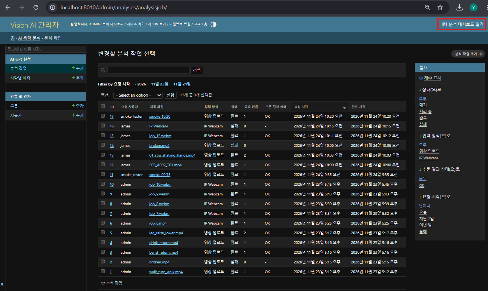</a> | <a href="reports/evidence/screenshots/T08_dashboard.png">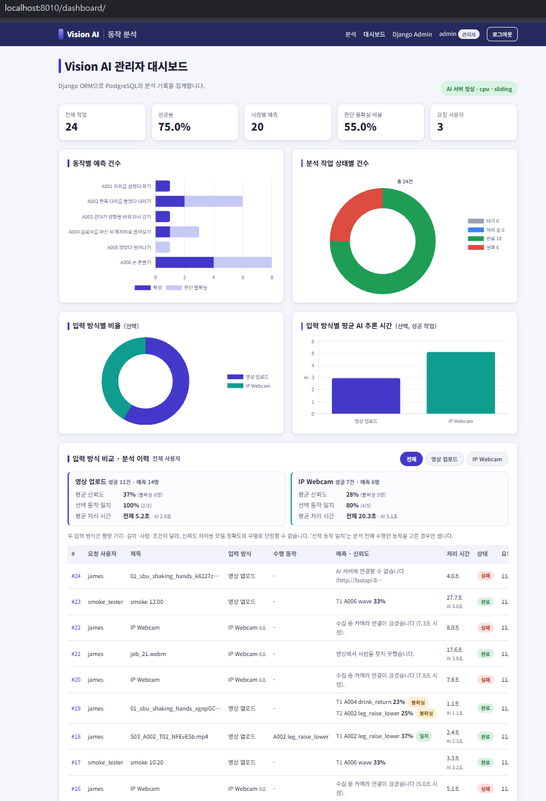</a> |
| Job list · status / input-type filters · user search · 'Analysis dashboard' link at the top | Predictions per action · jobs per status + input-type comparison (all users) |

<details>
<summary><b>More screens</b> — IP Webcam · two people · input comparison</summary>

| IP Webcam | Two people (separate tracks) | Input comparison |
|---|---|---|
| <a href="reports/evidence/screenshots/T03_webcam.png">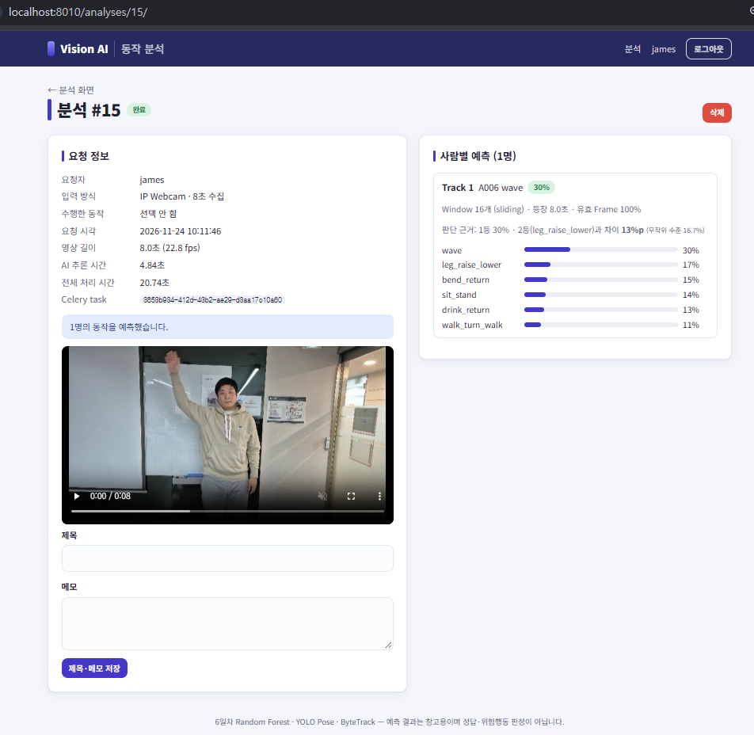</a> | <a href="reports/evidence/screenshots/T04_two_tracks.png">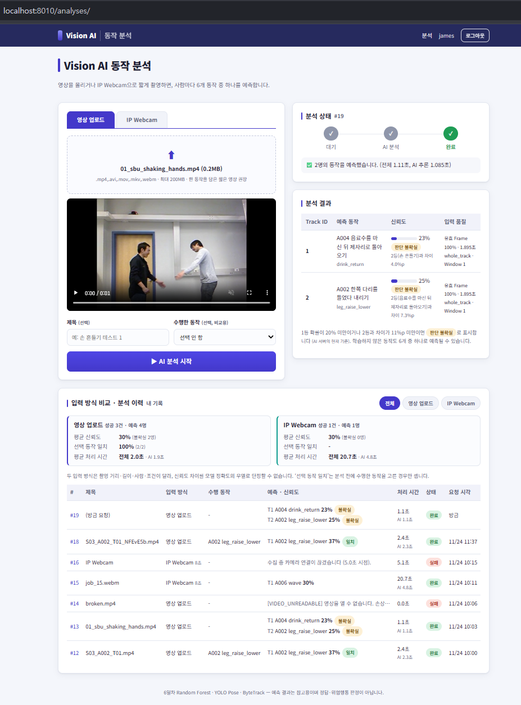</a> | <a href="reports/evidence/screenshots/compare.png">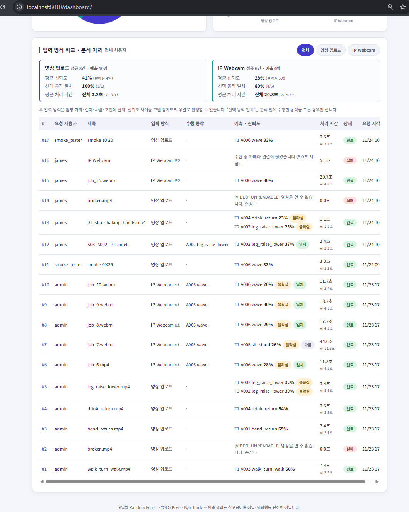</a> |
| 8-second phone IP Webcam capture → per-person prediction · evidence | Handshake video (untrained action) → 2 separate tracks, both **uncertain** | Upload vs IP Webcam: confidence · agreement · processing time |

</details>

### Model Reuse Check — Unseen Person (Held-out)

Checking on the training videos (S01, Day-4 originals) would naturally look perfect. So I evaluated videos of people **not used in training**, with **the same code as the service**.

| Rule | Details |
|---|---|
| Selection | choose the window strategy (4 options) and decision thresholds **on S02 (validation person) only** |
| Report | for **S03 (test person)**, report only the result of applying the chosen settings once (no tuning on S03) |
| Threshold score | confirmed correct − 2 × confirmed wrong → better to hold back than to confirm a wrong answer |
| Untrained actions | 3 **original** Day-8 SBU videos (handshake · hug · kick, 6 people) pass only if every prediction is 'uncertain' |

**Results** (2026-11-24 · 15 videos · 57 s on CPU)

| Setting | Data | Top-1 | Confirmed | Correct among confirmed | Held back |
|---|---|---|---|---|---|
| Original (`auto`, conf ≥ 0.55) | S02 | 3/6 | 0 | — | 6 |
| Original | S03 | 6/6 | 0 | — | 6 |
| **Chosen** (`sliding`, conf ≥ 0.20, margin ≥ 0.11) | S02 | 4/6 | 1 | 1/1 | 5 |
| **Chosen** | **S03 (test)** | 5/6 | 2 | **2/2** | 4 |
| **Chosen** | untrained actions (3 original SBU videos, 6 people) | — | **0** | — | 6 |

- **The original rule (0.55) confirmed nothing.** On S03 the top-1 class was right for all 6 videos, yet with probabilities of 0.19–0.37 every one was marked 'uncertain'.
- **The new rule confirmed 2 on S03 (leg_raise_lower gap 0.193 · wave 0.137), and both are correct.** The wrong one (walk_turn_walk → drink_return) had a gap of only 0.003 and was held back, and none of the 6 people doing untrained actions was confirmed.
- **Why the thresholds were re-chosen once:** the first evaluation used one Day-8 *result* video (`_tracked.mp4`, with skeletons drawn on it) as the untrained-action input and produced 0.28 / 0.03. After fixing the input to **3 original videos**, that rule confirmed some people doing untrained actions, so I re-chose on S02 + original SBU and got 0.20 / 0.11. This was not changed after looking at S03 (the S03 verdicts are the same under both rules).
- **Recorded honestly:** the S02-chosen `sliding` strategy lowered S03 Top-1 from 6/6 to 5/6. Re-choosing on the test data (S03) would stop it being a test, so I kept it; the one lost case was held back, so no wrong answer was confirmed. These are **provisional values** chosen from 6 videos per person.

Per-video verdicts: [`holdout_eval.md`](reports/evidence/holdout/holdout_eval.md) · raw predictions (video × strategy × person): [`predictions.csv`](reports/evidence/holdout/predictions.csv)

```bash
cd ai_service
python -m scripts.evaluate_holdout --videos ~/ai_vision/subject10_pose_action/data/day05/videos --negatives ~/ai_vision/negatives
```

### Functional Tests

| Test | Result | Evidence |
|---|---|---|
| T01 Model loading | ✅ 6 classes · 1,140 features · cross-check · **load only after SHA256 check** · standalone FastAPI inference in Swagger | <a href="reports/evidence/screenshots/T01_swagger_predict.png"></a><br>[`T01_model_load.txt`](reports/evidence/T01_model_load.txt) |
| T02 Video upload | ✅ job created → result saved. New person (S03) Top-1 5/6 · both confirmed predictions correct | <a href="reports/evidence/screenshots/T02_upload_result.png"></a><br>[`holdout_eval.md`](reports/evidence/holdout/holdout_eval.md) |
| T03 IP Webcam | ✅ 8-second capture from an allowlisted camera → same inference → saved | <a href="reports/evidence/screenshots/T03_webcam.png"></a> |
| T04 Per-person results | ✅ two-person video → 2 per-track predictions in one job | <a href="reports/evidence/screenshots/T04_two_tracks.png"></a> |
| T05 Async processing | ✅ **202 + job ID right away (0.1 s)**, processed by the Celery Worker | <a href="reports/evidence/screenshots/T05_async_smoke.png">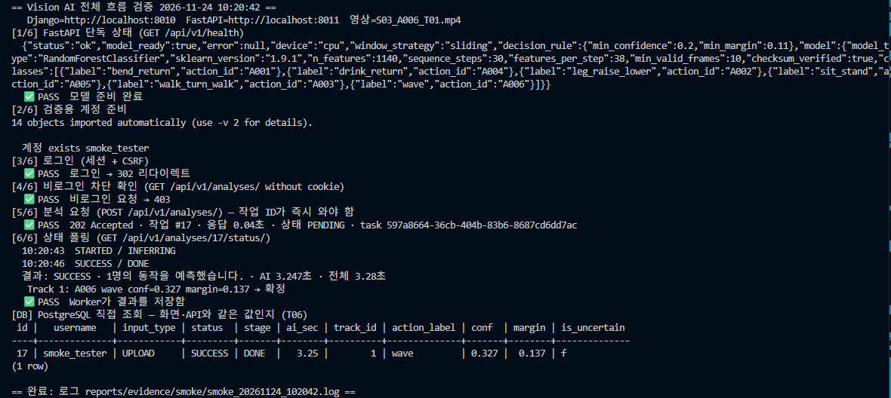</a><br>[`smoke logs`](reports/evidence/smoke/) · Worker stopped → waiting → resumed: [`T05_celery_worker_resume.txt`](reports/evidence/T05_celery_worker_resume.txt) |
| T06 Persistence | ✅ same jobs · predictions after refresh · PostgreSQL values = API values | <a href="reports/evidence/screenshots/T06_after_refresh.png">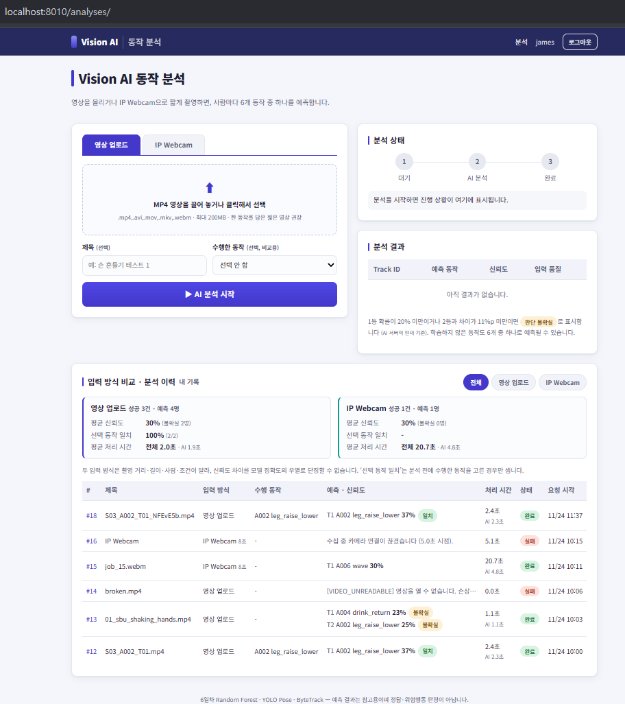</a> |
| T07 CRUD permissions | ✅ another member's job returns **404** for read · update · delete (member B requesting A's job) · sign-up rejects duplicate usernames · mismatched passwords | <a href="reports/evidence/screenshots/T07_other_user_404.png">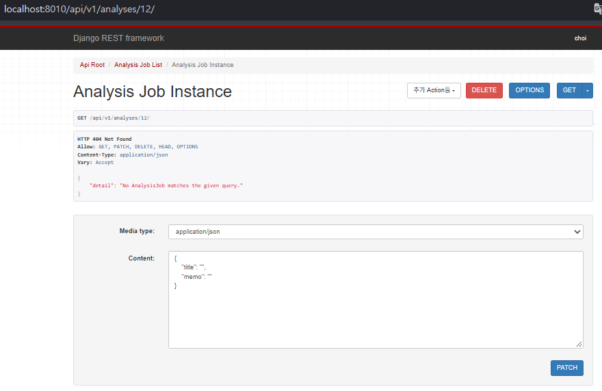</a><br><a href="reports/evidence/screenshots/T07_signup_errors.png">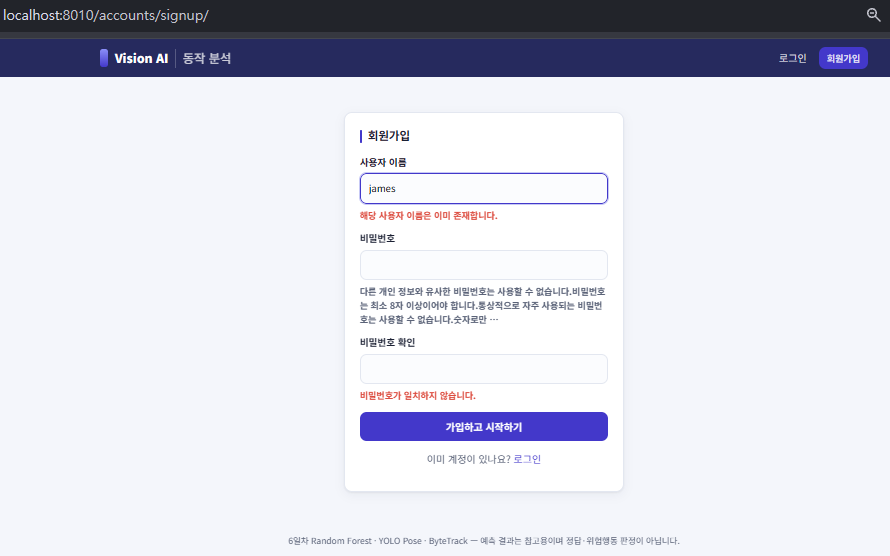</a> |
| T08 Staff | ✅ only staff see the dashboard · all records; regular members get **403** | <a href="reports/evidence/screenshots/T08_dashboard.png"></a><br><a href="reports/evidence/screenshots/T08_dashboard_forbidden.png">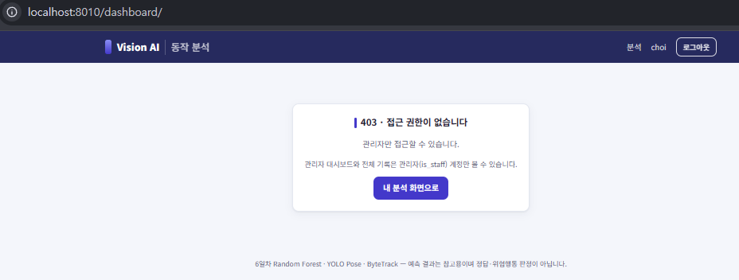</a><br>Dashboard numbers = direct DB query: [`T08_dashboard_vs_db.txt`](reports/evidence/T08_dashboard_vs_db.txt) |
| T09 Error handling | ✅ broken file · camera lost · **AI server down** → FAILURE + a user-facing reason (4 bad inputs to FastAPI alone: [`T09_fastapi_bad_inputs.txt`](reports/evidence/T09_fastapi_bad_inputs.txt)) | <a href="reports/evidence/screenshots/T09_broken_file.png"></a><br><a href="reports/evidence/screenshots/T09_camera_lost.png">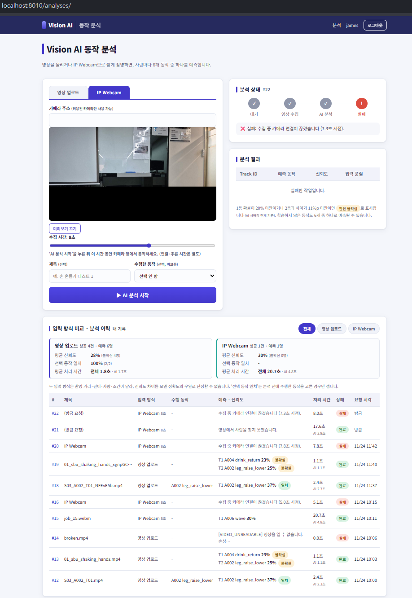</a><br><a href="reports/evidence/screenshots/T09_ai_server_down.png">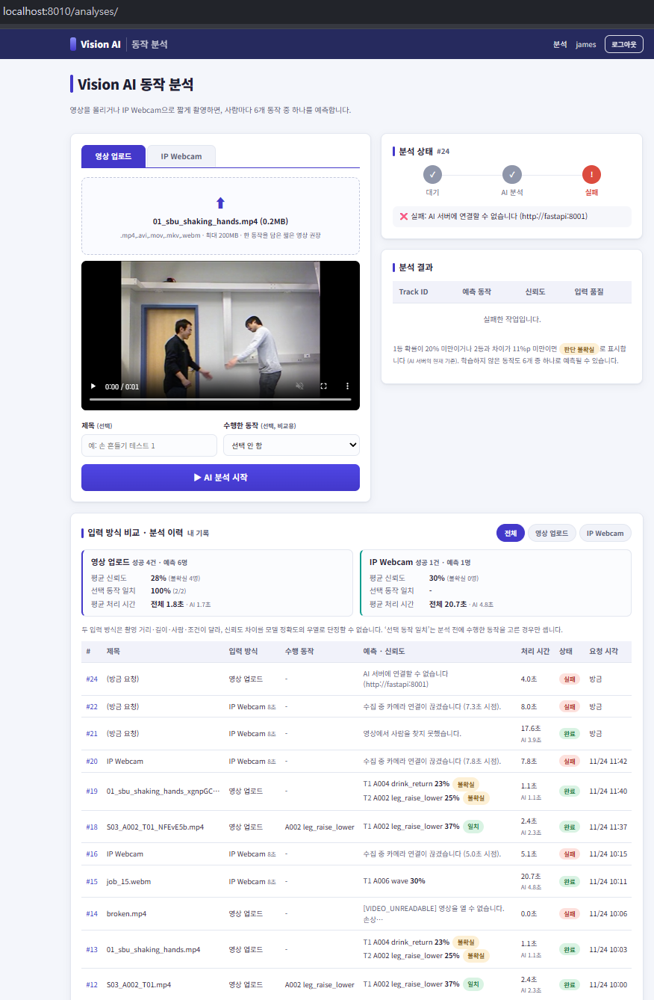</a> |
| T10 Docker | ✅ after `docker compose restart`, all 5 services Up · jobs · predictions kept | <a href="reports/evidence/screenshots/T10_restart.png">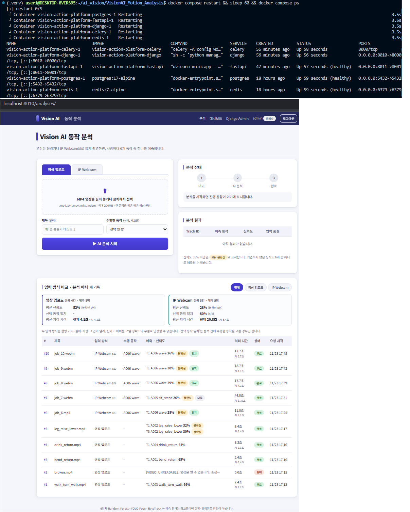</a><br>[`T10_after_restart.txt`](reports/evidence/T10_after_restart.txt) |

80 automated tests (FastAPI 45 · Django 35) — [`docs/development.md`](docs/development.md) · step-by-step manual verification (browser · Swagger · curl · Admin · Celery logs · PostgreSQL) — [`docs/verification.md`](docs/verification.md)

### Final Checklist (development guide, chapter 7)

| Item | Status | Verified by |
|---|---|---|
| Trained model loading and FastAPI action inference | ✅ | [steps 1 · 2](docs/verification.md) · T01 |
| Django · PostgreSQL · Admin connection | ✅ | step 3 · T08 |
| Sign-up · login · user permissions | ✅ | step 4 · T07 |
| DRF analysis job create · read | ✅ | step 5 · T07 |
| Redis · Celery async execution | ✅ | step 6 · T05 |
| Video upload → AI inference → DB save | ✅ | step 7 · T02 · T06 |
| IP Webcam → AI inference → DB save | ✅ | step 8 · T03 |
| User analysis page and result display | ✅ | step 9 · T02 |
| Staff dashboard with real statistics (checked against SQL) | ✅ | step 10 · T08 |
| Docker Compose 5-service integration · restart | ✅ | step 11 · T10 |

**Job status names**: unified as `PENDING → STARTED → SUCCESS / FAILURE`, a candidate in chapter 4 of the assignment and the Celery standard. The mapping to the guide's `PROCESSING · COMPLETED · FAILED` is in [`docs/verification.md`](docs/verification.md#작업-상태-표기).

### Design Decisions — Where I Differed from the Course Material

| Item | Course · Days 6–8 | This service | Why |
|---|---|---|---|
| Inference window | Day-7 5-second sliding-window average | **Compared 4 strategies on the same pose output** and chose on S02 → `sliding` | I first switched to the whole track because of a walk_turn_walk misclassification on training videos (day04) ([`ab_window_strategy.md`](reports/evidence/ab_window_strategy.md)), but on an untrained person (S02) sliding scored 4/6 > whole track 3/6 → followed the held-out result |
| Uncertain | confidence < 0.55 | confirm only when confidence ≥ 0.20 **and** top-1/2 gap ≥ 0.11 | at 0.55 even a new person's correct answers were all uncertain (S03: 0 confirmed). After the change: 2 confirmed on S03, both correct; 0 of 6 people confirmed on untrained actions |
| Model loading | call `joblib.load()` directly | load **after a SHA256 check** | pickle can run arbitrary code — first confirm it is the exact file I verified |
| Camera URL | free input | only host:port in `ALLOWED_CAMERA_HOSTS` · no credentials | prevents SSRF (the server calling arbitrary URLs) |
| Processing time | wall-clock difference | **monotonic clock** for the Worker part | WSL2 · Docker clock adjustments made the total shorter than inference → [`troubleshooting.md`](docs/troubleshooting.md) |

### More

| Document (Korean) | Contents |
|---|---|
| [`docs/design_qa.md`](docs/design_qa.md) | answers to the assignment's 18 design questions (why joblib alone cannot classify a video, `classes_`, ORM separation, async, etc.) |
| [`docs/troubleshooting.md`](docs/troubleshooting.md) | 7 problems solved — training/inference input mismatch, Docker build, browser playback, processing-time measurement, etc. |
| [`docs/api.md`](docs/api.md) | DRF · FastAPI API contracts and error codes |

**Known limitations**: the model was trained on 6 videos of one person (S01), so on new people · new environments the top-1 probability itself is low (IP Webcam 0.26–0.30). The thresholds were also chosen from 6 videos per person, so treat them as reference values; with more data, re-choose them with `evaluate_holdout.py`. YOLO also estimates joints outside the frame, so a landscape shot showing the full body is recommended. The Docker setup is for development (`runserver`, CPU inference).
