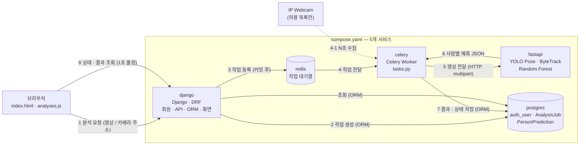
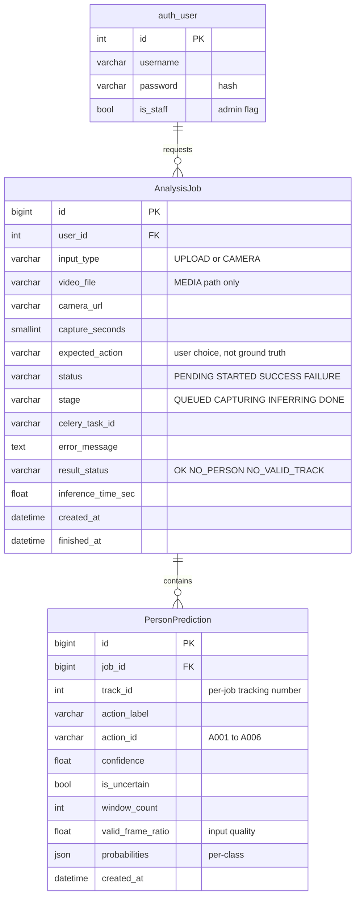
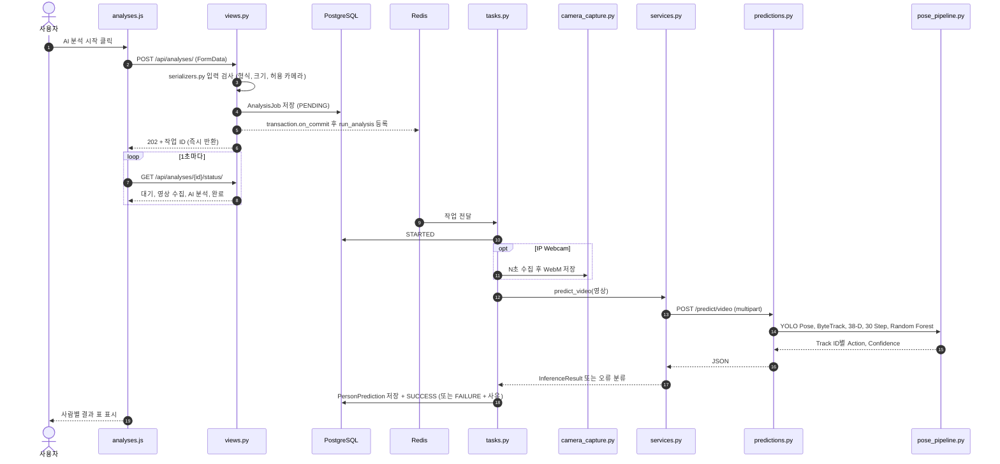
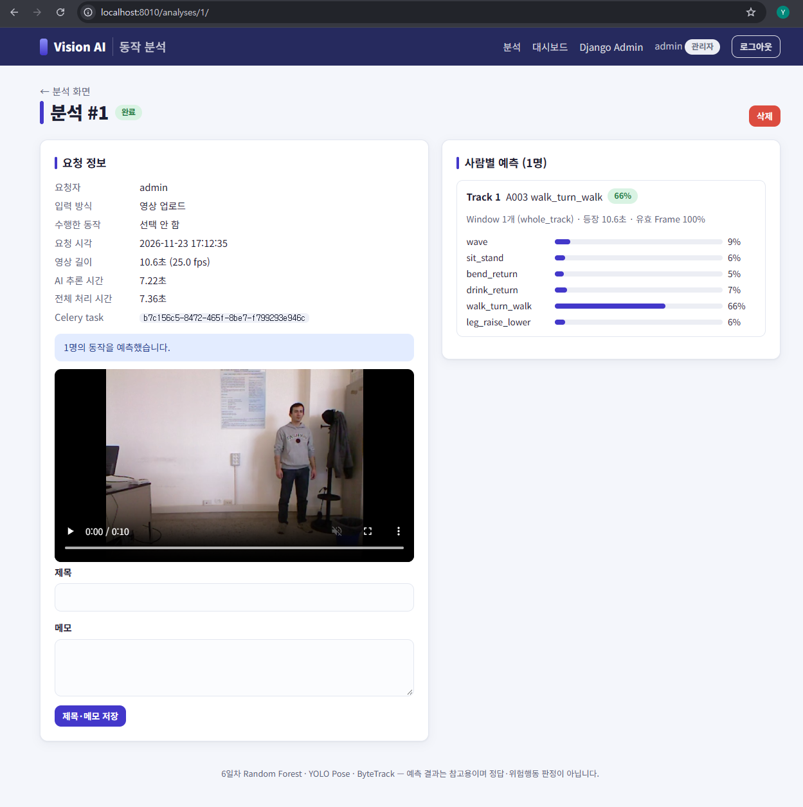
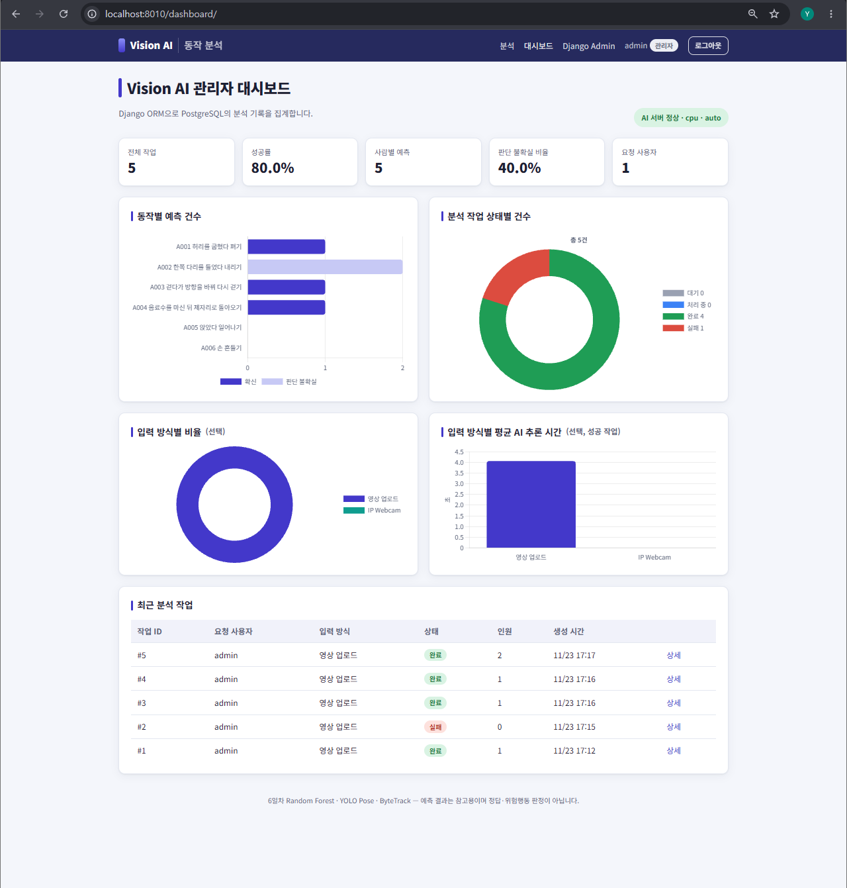

# VisionAI Motion Analysis

> 6일차에 학습한 **6개 동작 인식 Random Forest**를 재학습 없이 재사용해, 브라우저에서 **영상 업로드** 또는 **IP Webcam** 으로 AI 분석을 요청하고, 사람별 예측을 DB에 저장·조회하는 웹 서비스

       

| 한눈에 보기 | |
|---|---|
| 기능 테스트 | **T01~T10 전 항목 통과** (FastAPI 자동 테스트 24개 · Django 자동 테스트 22개) |
| 대표 결과 | 업로드 `walk_turn_walk` → **A003 0.66** (로컬 GPU와 Docker CPU 결과 동일) · IP Webcam 손 흔들기 → **3회 모두 wave 1순위** |
| 처리 시간 | 업로드 10.6초 영상: 전체 **7.4초** · IP Webcam 8초 수집: 전체 **17.7초** (개선 전 44.0초) |
| 근거 기반 결정 | A/B 실험 2건 — [Window 전략](reports/evidence/ab_window_strategy.md) · [IP Webcam 수집 조건](reports/evidence/ab_capture_condition.md) |

---

## 1. 프로젝트 소개

회원이 **짧은 MP4를 업로드**하거나 **휴대폰 IP Webcam으로 5~10초(기본 8초)를 촬영**하면, 영상 속 **사람마다(Track ID별)** 6개 동작 중 하나와 신뢰도를 예측해 보여 줍니다. 분석은 Celery Worker가 백그라운드에서 처리하므로 사용자는 작업 ID를 즉시 받고 `대기 → 영상 수집 → AI 분석 → 완료` 단계를 확인하며, 결과는 PostgreSQL에 저장되어 관리자가 Django Admin과 대시보드에서 전체 기록을 봅니다.

| ID | Action | 의미 |
|---|---|---|
| A001 | `bend_return` | 허리를 굽혔다 펴기 |
| A002 | `leg_raise_lower` | 한쪽 다리를 들었다 내리기 |
| A003 | `walk_turn_walk` | 걷다가 방향을 바꿔 다시 걷기 |
| A004 | `drink_return` | 음료수를 마신 뒤 제자리로 돌아오기 |
| A005 | `sit_stand` | 앉았다 일어나기 |
| A006 | `wave` | 손 흔들기 |

> ⚠️ 학습 데이터가 **3명 × 6동작**뿐이므로 예측 Label은 정답이나 위험행동 판정이 아닙니다. 학습하지 않은 동작도 6개 중 하나로 예측될 수 있어, 모든 결과에 **Confidence · Class별 확률 · 입력 품질**을 함께 표시하고 Confidence 0.55 미만은 **판단 불확실**로 표시합니다.

---

## 2. 실행 방법

### 2-1. 모델 준비 (Git에 포함되지 않음)

`*.joblib`, `*.pt`는 용량 때문에 Git에서 제외합니다. 원본 실습 프로젝트에서 복사하세요. JSON 2개는 저장소에 포함되어 있습니다.

| 파일 | 원본 위치 | 넣을 위치 |
|---|---|---|
| `rf_action_baseline.joblib` | `subject10_pose_action/artifacts/day06/` | `ai_service/models/` |
| `yolo11n-pose.pt` | `subject10_pose_action/` | `ai_service/models/` |
| `rf_feature_columns.json`, `rf_training_info.json` | `artifacts/day06/` | `ai_service/models/` (포함됨) |

### 2-2. Docker Compose로 전체 실행 (권장)

```bash
cp .env.example .env        # POSTGRES_PASSWORD, DJANGO_SECRET_KEY, ALLOWED_CAMERA_HOSTS 수정
docker compose up --build -d                                  # django · celery · fastapi · redis · postgres
docker compose ps                                             # 5개 Up, fastapi (healthy) — 첫 기동 1분 내외
docker compose exec django python manage.py createsuperuser   # 관리자 계정 (마이그레이션은 django 시작 시 자동)
```

| 화면 | 기본 주소 | 이 저장소의 실행 환경 |
|---|---|---|
| 사용자 분석 화면 | http://localhost:8000/ | http://localhost:8010/ |
| 관리자 대시보드 | `/dashboard/` (staff 계정) | http://localhost:8010/dashboard/ |
| Django Admin | `/admin/` | http://localhost:8010/admin/ |
| DRF API | `/api/analyses/` | http://localhost:8010/api/analyses/ |
| FastAPI 문서 | http://localhost:8001/docs | http://localhost:8011/docs |

**포트가 이미 사용 중이면** (`Bind for 0.0.0.0:8000 failed: port is already allocated`) `.env`에서 바깥 포트만 바꿉니다. 컨테이너끼리는 서비스 이름(`postgres`, `redis`, `fastapi`)으로 통신하므로 영향이 없습니다.

```bash
DJANGO_HOST_PORT=8010
FASTAPI_HOST_PORT=8011
DJANGO_CSRF_TRUSTED_ORIGINS=http://localhost:8010,http://127.0.0.1:8010
```

**IP Webcam 사용**: 휴대폰과 PC를 같은 Wi-Fi에 연결하고, 앱에 표시된 `IP:포트`를 `.env`의 `ALLOWED_CAMERA_HOSTS`에 등록한 뒤 `docker compose up -d --force-recreate django celery`. 허용 목록에 없는 주소는 서버가 호출하지 않습니다(SSRF 방지).

> fastapi 컨테이너는 **CPU**로 추론합니다. `ai_service/Dockerfile`은 PyTorch CPU 인덱스에서 `torch==2.15.0`과 `torchvision`을 **함께** 설치합니다(따로 설치하면 빌드 불일치 — §7 문제 해결 ②).

### 2-3. Docker 없이 로컬 개발 실행 (WSL)

```bash
docker compose up -d postgres redis                           # ① DB·브로커만 Docker로

cd ai_service && source .venv/bin/activate                    # ② AI 추론 서버 (터미널 1, GPU 사용)
uvicorn main:app --host 0.0.0.0 --port 8001

cd backend                                                    # ③ Django (터미널 2) — Python 3.12
uv venv --python 3.12.14 --seed .venv && source .venv/bin/activate
uv pip install -r requirements.txt
python manage.py migrate && python manage.py createsuperuser
python manage.py runserver 0.0.0.0:8000

cd backend && source .venv/bin/activate                       # ④ Celery Worker (터미널 3)
celery -A config worker --loglevel=INFO --concurrency=1
```

Redis·Worker 없이 화면만 빠르게 확인하려면 `.env`에 `CELERY_TASK_ALWAYS_EAGER=1`, `DB_ENGINE=sqlite`.

### 2-4. 테스트

```bash
cd ai_service && python -m pytest                         # 24개 — GPU·YOLO 불필요 (가짜 Pose 모델·가짜 RF)
cd backend && DB_ENGINE=sqlite python manage.py test      # 22개 — FastAPI·카메라는 가짜로 대체 (PostgreSQL에서도 통과)
```

---

## 3. 전체 아키텍처



| 구성 요소 | 책임 | 하지 않는 일 |
|---|---|---|
| **Django + DRF** | 회원·CRUD·분석 요청 접수·조회·관리 화면·ORM | AI 추론, 모델 학습 |
| **Celery Worker** | 영상 확보(업로드 파일 / 카메라 수집) → FastAPI 호출 → **Django ORM으로 결과 저장** | 화면 렌더링 |
| **FastAPI** | 영상 → YOLO Pose·ByteTrack → 38-D Feature → 30 Step → Random Forest → JSON | **DB 접근·ORM·회원 관리** |
| **Redis** | Celery 메시지 브로커 | 영구 업무 데이터 저장 |
| **PostgreSQL** | 사용자·분석 작업·사람별 예측 영구 저장 (`postgres_data` 볼륨) | — |

업로드·수집 영상은 `media_data` 볼륨에 저장되어 django·celery가 같은 경로로 공유합니다. FastAPI에는 파일 경로가 아니라 **영상 자체를 HTTP로 전송**하므로 컨테이너 간 `localhost` 가정이 없습니다.

---

## 4. DB 설계 (ERD)



| 테이블 | 저장하는 것 | 작성 위치 |
|---|---|---|
| `auth_user` | 로그인 계정 (Django 기본 제공) | — |
| `AnalysisJob` | 분석 요청 1건과 진행 상태·오류·처리 시간 | **`backend/analyses/models.py`** |
| `PersonPrediction` | 영상 속 사람별 예측 — 2명이 나온 영상이면 작업 1건에 예측 2건 (`UNIQUE(job, track_id)`) | **`backend/analyses/models.py`** |

- 영상 파일 자체는 DB에 넣지 않고 MEDIA에 저장, DB에는 경로만 기록
- `track_id`는 한 작업 안의 추적 번호이지 영구적인 사람 ID가 아님
- 삭제 정책: 완료·실패한 작업만 삭제 가능(진행 중이면 409). 삭제 시 사람별 예측은 CASCADE, 영상 파일도 함께 정리
- 일반 회원은 다른 회원의 작업에 접근하면 **404** (존재 여부도 숨김), 상태·AI 결과는 PATCH로 수정 불가(제목·메모만)

---

## 5. AI 분석 버튼 구현 흐름



| 단계 | 대표 파일 |
|---|---|
| 버튼 · 폴링 · 결과 표시 | `backend/static/js/analyses.js`, `backend/templates/analyses/index.html` |
| 요청 접수 · 작업 등록 | `backend/analyses/views.py`, `serializers.py` |
| 영상 확보 · 결과 저장 | `backend/analyses/tasks.py`, `camera_capture.py`, `services.py` |
| 추론 API | `ai_service/routers/predictions.py`, `main.py` |
| 추론 로직 | `ai_service/services/pose_pipeline.py`, `action_inference.py`, `model_loader.py` |

**왜 작업 ID를 먼저 돌려주나?** 추론은 수 초~수십 초가 걸립니다. 요청 함수가 끝까지 기다리면 브라우저가 멈추고 서버 스레드도 묶입니다. 작업을 큐에 넘기고 즉시 202를 반환하면, 사용자는 진행 단계를 보며 기다리고 여러 요청을 Worker가 순서대로 처리합니다.

---

## 6. 사용한 모델과 입력 형식

| 항목 | 내용 |
|---|---|
| 동작 분류 모델 | `rf_action_baseline.joblib` — 6일차 RandomForestClassifier (scikit-learn 1.9.1), **재학습 없음** |
| 입력 규격 | `rf_feature_columns.json` — 1,140 = **30 Step × 38 Feature** (COCO 17 Keypoint x·y 어깨폭 정규화 34 + 팔꿈치·무릎 각도 4) |
| 모델 로드 검증 | 시작 시 3개 파일 교차 검증 7항목 (Feature 수·배치·Class 구성 등) + scikit-learn 버전 불일치는 오류로 처리 |
| Pose · 추적 | `yolo11n-pose.pt` + ByteTrack, 영상마다 Tracker 초기화 |
| 재사용 코드 | 원본 `src/` 5개를 **수정 없이** 복사: `pose_utils` · `feature_utils` · `sequence_utils` · `realtime_utils` · `multi_person_utils` |
| 환경 고정 | Python 3.12.14, scikit-learn·numpy·joblib·ultralytics·opencv·lap·pandas를 학습 환경과 같은 버전으로 고정 |
| 업로드 형식 | `.mp4 .avi .mov .mkv .webm`, 최대 200MB, 최대 60초 |
| IP Webcam | 허용 목록 카메라만, **5~10초(기본 8초)** 수집 → 30fps · 640px **WebM**으로 저장 → 업로드와 같은 추론 |
| Window 전략 | `auto`: 사람이 보인 시간 ≤ 12초면 전체 구간 1개(`whole_track`, 6일차 학습 방식), 길면 5초 Sliding Window 확률 평균 |
| 판단 불확실 | Confidence < 0.55 (7일차 `confidence_threshold`) |

**FastAPI 입출력** — `POST /predict/video` (multipart `file`)

```json
{
  "status": "OK",
  "message": "1명의 동작을 예측했습니다.",
  "predictions": [
    {"track_id": 1, "action_id": "A003", "action_label": "walk_turn_walk", "confidence": 0.66,
     "is_uncertain": false, "window_mode": "whole_track", "window_count": 1,
     "valid_frame_ratio": 1.0, "duration_sec": 10.6, "probabilities": {"walk_turn_walk": 0.66}}
  ],
  "skipped_tracks": [],
  "video": {"fps": 30.0, "processed_frames": 318, "duration_sec": 10.6},
  "uncertain_threshold": 0.55,
  "processing_time_sec": 7.2
}
```

| FastAPI 응답 | 의미 | Celery Worker 처리 |
|---|---|---|
| 200 `OK` | 사람별 예측 1건 이상 | SUCCESS + PersonPrediction 저장 |
| 200 `NO_PERSON` / `NO_VALID_TRACK` | 영상 정상, 사람 없음 / 너무 짧게 보임 | SUCCESS (예측 0건 + 메시지) |
| 4xx `VIDEO_UNREADABLE` · `VIDEO_TOO_LONG` 등 | 입력 문제 | FAILURE + 사유 (재시도 안 함) |
| 503 · 연결 실패 · 타임아웃 | AI 서버 일시 장애 | 최대 3회 재시도 후 FAILURE |

---

## 7. 실행 결과와 검증

### 실행 화면

| 정상 분석 (영상 업로드) | IP Webcam 분석 |
|---|---|
|  |  |
| `walk_turn_walk.mp4` (10.6초) → **A003 walk_turn_walk 0.66**, AI 추론 7.2초 (Docker CPU) | 8초 수집(21.9fps) → **A006 wave 0.30 · 판단 불확실 · 선택 동작과 일치**, 전체 18.7초 |

| 오류 · 실패 | 관리자 대시보드 |
|---|---|
|  |  |
| 텍스트 파일을 `broken.mp4`로 업로드 → `FAILURE` · `[VIDEO_UNREADABLE] 영상을 열 수 없습니다` | 동작별 예측 건수 · 작업 상태별 건수 (필수 2) + 입력 방식 비율 · 평균 추론 시간 (선택 2) |

### 기능 테스트

| 테스트 | 입력 · 상황 | 결과 | 증거 |
|---|---|---|---|
| T01 모델 불러오기 | 6일차 모델·JSON 3개 | ✅ 6 Class · 1,140 Feature · 교차 검증 통과 | [`T01_model_load.txt`](reports/evidence/T01_model_load.txt) |
| T02 영상 업로드 | 원본 day04 동작 영상 6개 | ✅ 6/6 정답 (whole_track) · Docker에서 walk_turn_walk 0.66 재현 | [`ab_window_strategy.md`](reports/evidence/ab_window_strategy.md) |
| T03 IP Webcam | 휴대폰 카메라 8초 수집, 손 흔들기 | ✅ 3회 모두 wave 1순위 (0.26~0.30, 판단 불확실) | [`ab_capture_condition.md`](reports/evidence/ab_capture_condition.md) |
| T04 사람별 결과 | SBU 2인 영상 | ✅ Track 1 · 2 분리, 작업 1건에 예측 2건 | [`T02_T04/01_sbu_shaking_hands.json`](reports/evidence/T02_T04/01_sbu_shaking_hands.json) |
| T05 비동기 처리 | 분석 요청 직후 | ✅ 202 + 작업 ID 즉시 반환, 커밋 후 Celery 등록 | `test_upload_creates_job_and_saves_predictions` |
| T06 영구 저장 | 완료 후 새로고침 | ✅ 작업·예측 유지 | 〃 |
| T07 CRUD 권한 | 회원 A / B | ✅ B는 A의 작업 조회·수정·삭제·상태 조회 모두 404 | `test_user_cannot_touch_others_jobs` |
| T08 관리자 | staff / 일반 계정 | ✅ staff만 대시보드, 일반 회원 403 | `test_dashboard_staff_only` |
| T09 예외 처리 | 손상 파일 · 카메라 끊김 · AI 서버 장애 | ✅ FAILURE + 사용자용 사유 저장 (작업 #2) | `test_corrupt_video_marks_failure` 외 |
| T10 Docker | `docker compose restart` | ✅ 재시작 후 작업 5건 · 예측 5건 유지 | [`T10_after_restart.txt`](reports/evidence/T10_after_restart.txt) |

### 입력 방식 비교

| 입력 방식 | 수행 동작 | 예측 | Confidence | 영상 | AI 추론 | 전체 |
|---|---|---|---|---|---|---|
| 영상 업로드 (원본 day04) | walk_turn_walk | ✅ walk_turn_walk | 0.66 | 10.6초 @30fps | 7.2초 | 7.4초 |
| IP Webcam 8초 | wave | ✅ wave (불확실) | 0.30 | 8.0초 @21.9fps | 4.1초 | 18.7초 |
| IP Webcam 5초 | wave | ✅ wave (불확실) | 0.26 | 5.0초 @21.6fps | 2.7초 | 11.7초 |

> 두 입력은 **사람·거리·길이·동작이 모두 달라** Confidence 차이를 정확도 우열로 볼 수 없습니다. 업로드 영상은 학습 원본일 가능성이 높고, IP Webcam은 처음 보는 사람·장소입니다. 전체 시간 차이는 대부분 **수집 시간과 WebM 저장**입니다.

### 문제 해결 기록 (문제 → 확인 → 변경 → 검증)

| # | 문제 | 확인 | 변경 | 검증 |
|---|---|---|---|---|
| ① | walk_turn_walk(10.6초)가 drink_return 0.20으로 오분류 | 학습은 *Clip 전체* → 30 Step, 추론은 *5초 Window 24개* 평균 → Window마다 동작 일부만 담김 | `window.strategy` 설정 추가, 기본 `auto` | 같은 7개 영상 A/B: 5/6 → **6/6**, walk_turn_walk 0.20 오답 → 0.66 정답 |
| ② | Docker fastapi가 healthy가 되지 않음 | `/health`의 `error`와 로그 `operator torchvision::nms does not exist` → CPU torch + PyPI torchvision 빌드 불일치 | torch·torchvision을 CPU 인덱스에서 함께 설치 | 컨테이너 안 버전 둘 다 `+cpu`, `model_ready: true` |
| ③ | celery 컨테이너 재시작 반복 | `No module named 'packaging'` — 개발 PC에 우연히 있던 패키지에 의존 | 깨끗한 venv에서 재현 후 `celery[redis]`로 변경 | 깨끗한 venv·컨테이너에서 Worker `ready` |
| ④ | `port is already allocated` (8000·8001), 이어서 `failed to resolve host 'postgres'` | 다른 프로젝트가 같은 포트 사용, 중단된 첫 실행의 컨테이너가 네트워크에 제대로 붙지 않음 | 바깥 포트를 `*_HOST_PORT` 변수로, 컨테이너 재생성 | 8010·8011로 5개 서비스 정상 |
| ⑤ | IP Webcam 영상이 상세 화면에서 재생 안 됨 | OpenCV `mp4v`는 Chrome 미지원(MEDIA_ERR 4), 업로드 원본은 H.264라 재생됨 | 수집 영상을 **WebM(VP8)** 으로 저장 (실패 시 MP4 대체) | Chrome에서 재생·길이 정상, 테스트 추가 |
| ⑥ | IP Webcam 전체 처리 44초 | 스트림 버퍼 몰림(55fps) + VP8 인코딩이 Frame 수·해상도에 비례 | 30fps 간격 · 640px로 저장 | 44.0초 → **17.7초**, AI 추론 11.9초 → 4.3초 |

### IP Webcam 신뢰도 실험 — 가설 기각도 결과다

신뢰도가 0.3 안팎에 머무는 원인으로 "수집 구간에 정지 동작이 섞였다"를 의심해, 같은 사람·위치·구도에서 조건을 하나씩 바꿨습니다.

| 조건 | 1순위 | 2순위 | 차이 |
|---|---|---|---|
| 8초, 중간에 쉼 | wave 0.29 | bend_return 0.19 | 0.10 |
| 8초, 수집 내내 동작 | wave 0.30 | leg_raise_lower 0.19 | 0.11 |
| 5초, 수집 내내 동작 | wave 0.26 | leg_raise_lower 0.20 | 0.06 |

→ 3회 모두 wave 1순위로 **일관**되지만 신뢰도는 개선되지 않아 가설을 기각했습니다. 원인은 학습 데이터(3명·특정 장소)와 새 사람·새 환경의 차이이며 재학습 없이는 개선할 수 없습니다. 기본 수집 시간 8초와 불확실 기준 0.55를 유지합니다(학습하지 않은 동작도 0.23~0.25가 나오므로 기준을 낮추면 모르는 동작을 '확신'으로 표시하게 됨).

### 알려진 한계

- 학습 데이터가 3명 × 6동작이라 새 사람·새 환경에서는 신뢰도가 낮거나 틀릴 수 있음 → 원인 탐색 순서: 입력 품질 → Pose → Feature → Window → 모델
- YOLO는 화면 밖 관절도 추정 좌표를 내므로 `valid_frame_ratio`(Feature 계산 성공 비율)가 100%여도 하체가 가려졌을 수 있음 → 전신이 나오는 가로 구도 권장
- ByteTrack ID가 바뀌면 한 사람이 두 Track으로 나뉠 수 있음 (leg_raise_lower 영상에서 관찰)
- day04 검증 영상은 학습 원본일 가능성이 높아 정확도가 아닌 **이관 파이프라인 회귀 확인**의 의미
- Docker 구성은 개발용(`runserver`, fastapi CPU 추론)이며 운영 배포에는 WSGI 서버·정적 파일 서빙·GPU 설정이 추가로 필요

---

## 프로젝트 구조

```text
VisionAI_Motion_Analysis/
├── backend/                      Django·DRF·Celery (같은 Dockerfile로 django·celery 실행)
│   ├── config/                   settings · urls · celery
│   ├── accounts/                 회원가입·로그인 (Django 기본 User)
│   ├── analyses/                 models · serializers · views(API) · page_views(화면·대시보드)
│   │                             tasks · services · camera_capture · admin · constants · tests
│   ├── templates/                base · login · signup · index · detail · dashboard
│   ├── static/                   app.css · analyses.js · dashboard.js · vendor/chart.umd.min.js (오프라인 동작)
│   └── Dockerfile · requirements.txt
├── ai_service/                   FastAPI 추론 서버
│   ├── main.py · routers/predictions.py
│   ├── services/                 model_loader · pose_pipeline · action_inference
│   ├── src/                      원본 실습 코드 5개 (수정 없음)
│   ├── models/                   joblib·pt (Git 제외) + JSON 2개
│   └── project.json · tests/ · Dockerfile · requirements.txt
├── reports/evidence/             T01~T10 증거 · A/B 실험 기록 · screenshots/
├── compose.yaml · .env.example · .gitignore
└── README.md
```
