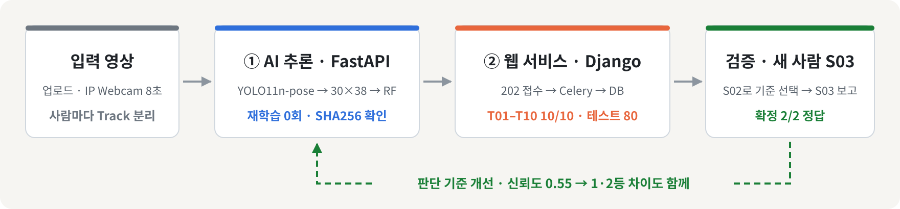
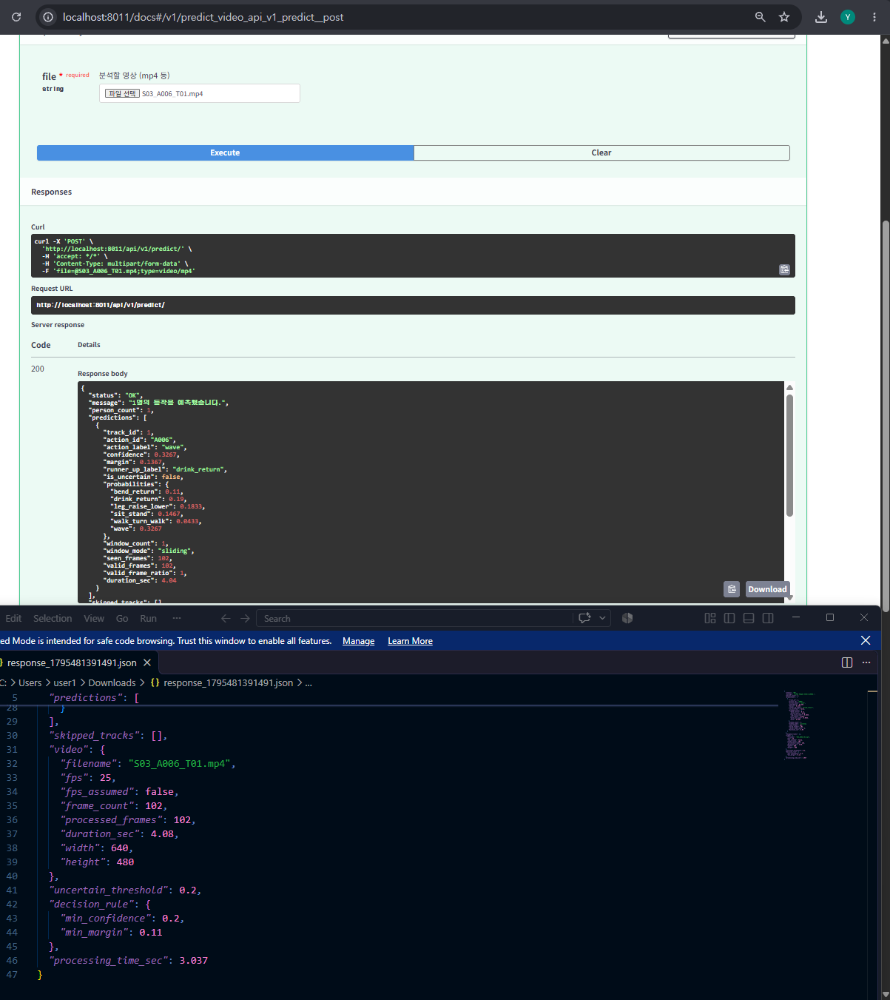
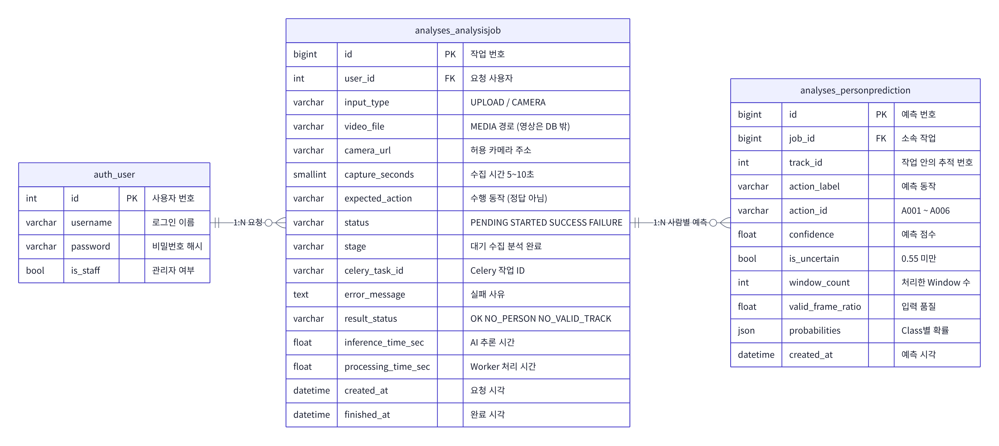
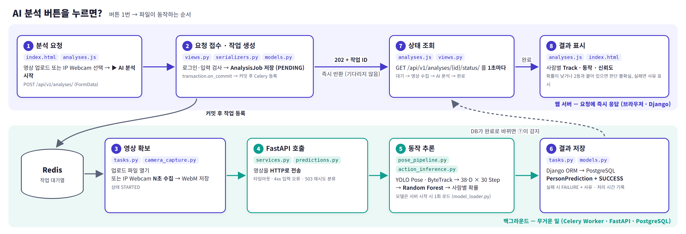
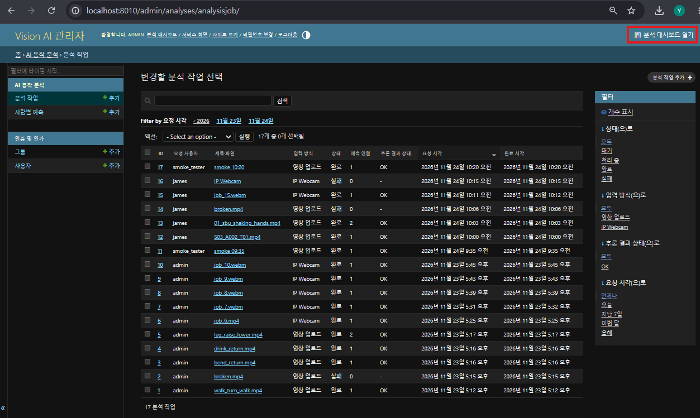
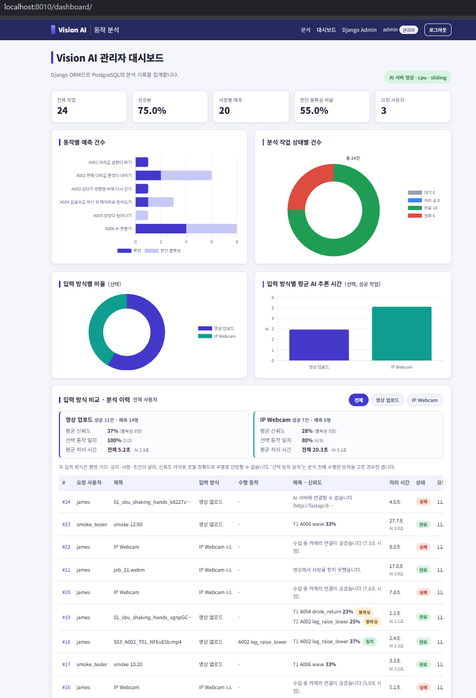
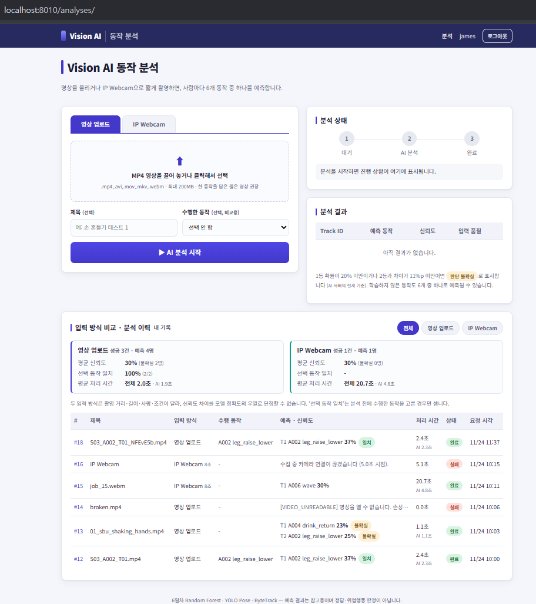
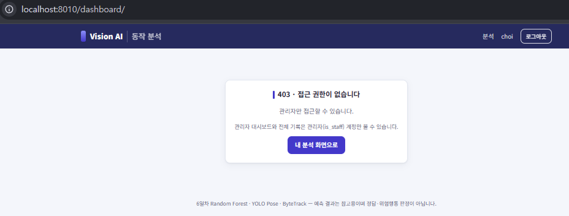
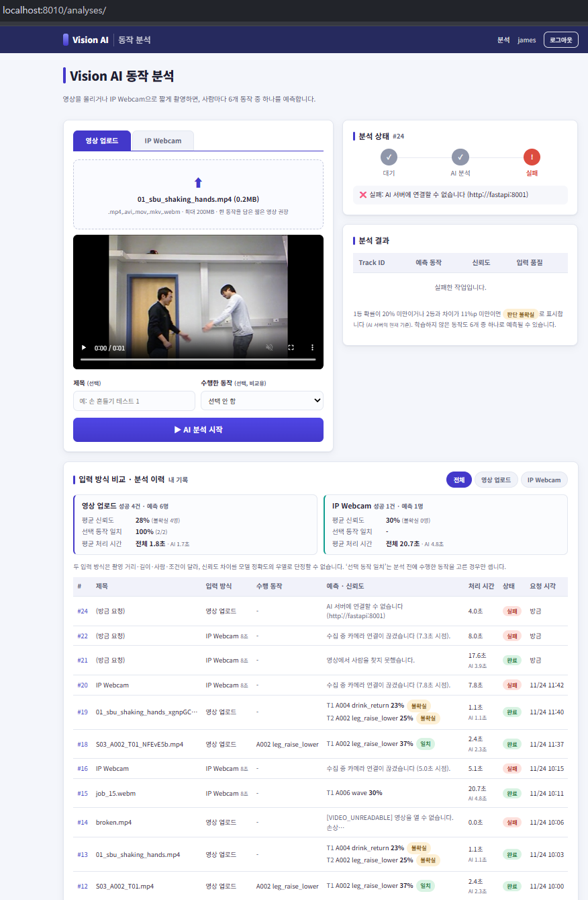
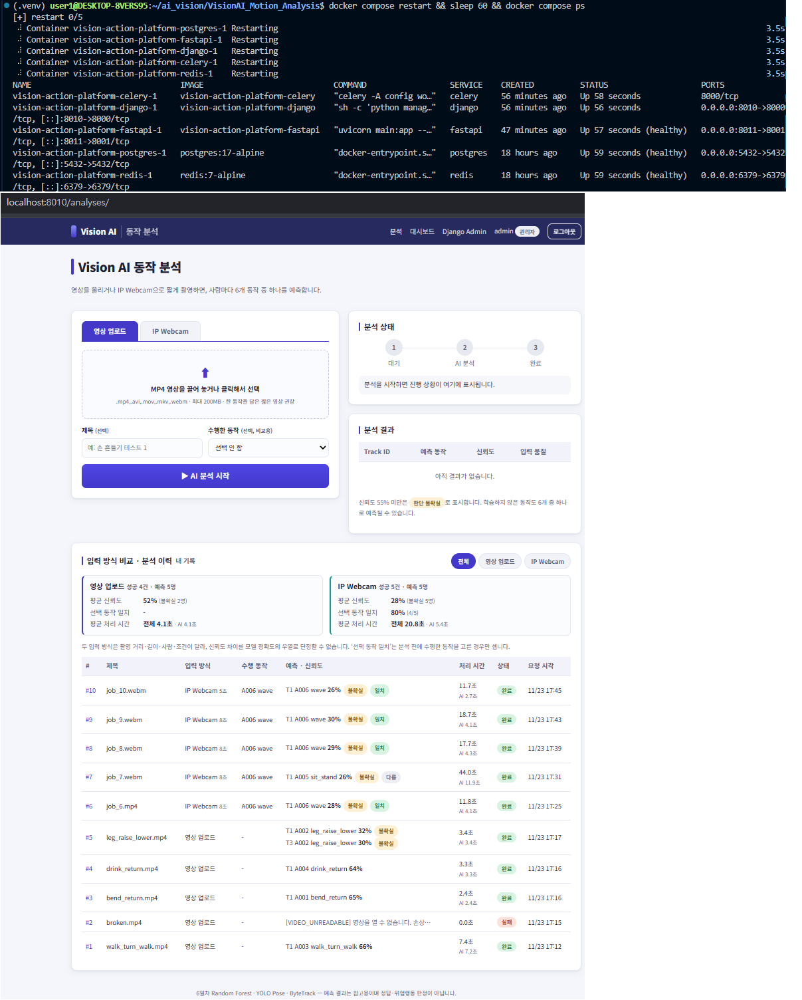

<div align="center">

# 6개 동작 인식 · 학습된 모델 재사용부터 비동기 웹 서비스까지

</div>

<p align="center">
         <br>
        <br>
    
</p>

6일차에 학습한 **Random Forest**(30 Step × 38 Feature = 1,140개 입력)를 **재학습 없이** 가져와, 영상 업로드 · 휴대폰 IP Webcam 8초 촬영 → YOLO11n-pose + ByteTrack → **사람별 6개 동작 예측**을 Django · Celery · FastAPI · PostgreSQL 등 Docker Compose 5개 서비스로 배포했습니다.
학습 데이터가 한 사람(S01)뿐이라 기존 신뢰도 0.55 기준으로는 새 사람(S03)에서 **확정 0건**이었고, 1·2등 확률 차이를 함께 보는 기준을 검증용 사람(S02)으로만 골라 **확정 2건 모두 정답 · 학습 안 한 동작 0 / 6 확정**을 확인했습니다.

## 한눈에 보기

<p align="center">
  
</p>

<table>
  <tr>
    <th width="10%"></th>
    <th width="45%">① AI 추론 · 모델 재사용</th>
    <th width="45%">② 웹 서비스 · 비동기 처리</th>
  </tr>
  <tr>
    <td align="center"><b>한 일</b></td>
    <td>모델 파일 3종 교차 검증 · 학습 때와 같은 Feature 생성 코드 재사용 · Window 전략 비교 · 판단 불확실 기준 재설계</td>
    <td>회원 · 권한(DRF) · 커밋 후 Celery 등록 · 실패 시 재시도 · IP Webcam 허용 목록 · Admin · 대시보드</td>
  </tr>
  <tr>
    <td align="center"><b>핵심 숫자</b></td>
    <td>새 사람 S03 Top-1 <b>5 / 6</b> · 확정 <b>2 / 2</b> 정답 · 학습 안 한 동작 확정 <b>0 / 6</b> · Feature 순서를 뒤집으면 <b>0.500 → 0.167</b></td>
    <td>접수 <b>0.1초 이내 (202)</b> · Worker 25초 중단에도 작업 유실 <b>없음</b> · T01–T10 <b>10 / 10</b> · 자동 테스트 <b>80</b></td>
  </tr>
  <tr>
    <td align="center"><b>문서</b></td>
    <td><a href="reports/evidence/holdout/holdout_eval.md">Held-out 검증</a> · <a href="docs/design_qa.md">설계 Q&amp;A</a></td>
    <td><a href="docs/api.md">API</a> · <a href="docs/verification.md">단계별 검증</a> · <a href="docs/troubleshooting.md">문제 해결</a></td>
  </tr>
  <tr>
    <td align="center"><b>한눈에</b></td>
    <td align="center" valign="top"><br>FastAPI 단독 추론 (Swagger)</td>
    <td align="center" valign="top"><br>사람별 결과 · 신뢰도 · 1·2등 차이</td>
  </tr>
</table>

---

## 1. 프로젝트 소개

회원이 **짧은 영상을 업로드**하거나 **휴대폰 IP Webcam으로 5~10초를 촬영**하면, 영상 속 **사람마다** 6개 동작 중 하나와 신뢰도를 예측해 보여 주는 서비스입니다. 분석은 Celery Worker가 백그라운드에서 처리하므로 사용자는 작업 ID를 즉시 받아 진행 단계를 확인하고, 결과는 PostgreSQL에 저장되어 관리자가 Django Admin과 대시보드에서 전체 기록과 입력 방식별 비교를 봅니다.

| A001 `bend_return` | A002 `leg_raise_lower` | A003 `walk_turn_walk` | A004 `drink_return` | A005 `sit_stand` | A006 `wave` |
|---|---|---|---|---|---|
| 허리 굽혔다 펴기 | 한쪽 다리 들었다 내리기 | 걷다가 방향 바꿔 걷기 | 음료 마신 뒤 돌아오기 | 앉았다 일어나기 | 손 흔들기 |

> 6일차 모델은 **S01 한 사람의 영상 6개**로 학습했기 때문에 예측은 **정답이나 위험행동 판정이 아닙니다.** 모든 결과에 Confidence · **2등과의 확률 차이** · Class별 확률 · 입력 품질을 함께 보여 주고, 1등 확률이 낮거나 2등과 붙어 있으면 **판단 불확실**로 표시합니다. 기준값은 학습하지 않은 사람(S02)으로만 골랐습니다 → [7. Held-out 검증](#모델-재사용-검증--학습하지-않은-사람-held-out)

---

## 2. 실행 방법

**① 모델 준비** — `*.joblib`, `*.pt`는 Git에서 제외합니다. 원본 실습에서 `ai_service/models/`로 복사하세요.

| 파일 | 원본 위치 |
|---|---|
| `rf_action_baseline.joblib` | `subject10_pose_action/artifacts/day06/` (`scripts/35_train_rf_baseline.py`가 저장) |
| `yolo11n-pose.pt` | `subject10_pose_action/` |
| `rf_feature_columns.json`, `rf_training_info.json`, `SHA256SUMS.txt` | 저장소에 포함됨 |

`joblib.load()`는 pickle을 실행하므로, AI 서버는 **`SHA256SUMS.txt`의 해시와 같은 파일만** 엽니다. 다른 실행에서 나온 joblib을 넣으면 시작 단계에서 거부합니다.

```bash
cd ai_service
python -m services.model_loader      # T01: 3개 파일 교차 검증 + SHA256 확인 → [T01 PASS] · SHA256 verified: True
```

**② 실행**

```bash
cp .env.example .env                                           # POSTGRES_PASSWORD · DJANGO_SECRET_KEY · ALLOWED_CAMERA_HOSTS 수정
docker compose up --build -d                                   # 5개 서비스 실행 (fastapi healthy까지 약 1분)
docker compose exec django python manage.py migrate            # 마이그레이션 적용 (django 시작 시에도 자동 실행)
docker compose exec django python manage.py createsuperuser    # 관리자 계정 생성
docker compose ps                                              # 5개 모두 Up 확인
```

**③ 접속** (경로 규칙은 개발 가이드 5장의 권장 설계를 따름)

| 대상 | 주소 |
|---|---|
| 회원가입 · 로그인 | http://localhost:8000/accounts/signup/ · http://localhost:8000/accounts/login/ |
| 사용자 분석 화면 | http://localhost:8000/analyses/ |
| 분석 API (DRF) | `POST`·`GET` http://localhost:8000/api/v1/analyses/ · `GET /api/v1/analyses/{id}/` · `GET /api/v1/analyses/{id}/status/` |
| 관리자 대시보드 · Django Admin | http://localhost:8000/dashboard/ · http://localhost:8000/admin/ (Admin 상단에 대시보드 링크) |
| FastAPI 문서 · 추론 | http://localhost:8001/docs · `POST /api/v1/predict/` (과제 문서 계약 `POST /predict/video`와 같은 함수) |

**④ 전체 흐름 확인** — 로그인 → 업로드 → 202 + 작업 ID → 상태 조회 → PostgreSQL 조회까지 curl로 한 번에 확인하고 로그를 남깁니다.

```bash
bash scripts/smoke_e2e.sh ~/ai_vision/subject10_pose_action/data/day05/videos/S03/S03_A006_T01.mp4
```

> 포트가 이미 사용 중이면 `.env`에서 `DJANGO_HOST_PORT`·`FASTAPI_HOST_PORT`만 바꾸면 됩니다(이 저장소의 시연 환경은 8010·8011). IP Webcam은 휴대폰과 PC를 같은 Wi-Fi에 두고 앱의 `IP:포트`를 `ALLOWED_CAMERA_HOSTS`에 등록합니다.
> Docker 없이 실행하기 · 테스트 실행 → [`docs/development.md`](docs/development.md)

---

## 3. 전체 아키텍처


| 서비스 | 책임 | 하지 않는 일 |
|---|---|---|
| **django** (Django + DRF) | 회원 · 분석 요청 접수 · 권한 · 조회 · 관리 화면 · ORM | AI 추론 |
| **celery** (Celery Worker) | 영상 확보(업로드 / 카메라 수집) → FastAPI 호출 → **Django ORM으로 결과 저장** | 화면 렌더링 |
| **fastapi** | YOLO Pose · ByteTrack → 1,140 Feature → Random Forest → JSON 반환 | **DB 접근** |
| **redis** | Celery 작업 대기열 | 영구 데이터 저장 |
| **postgres** | 사용자 · 분석 작업 · 사람별 예측 영구 저장 | — |

---

## 4. DB 설계 (ERD)



| 테이블 | 저장하는 것 | 작성 위치 |
|---|---|---|
| `auth_user` | 로그인 계정 (Django 기본 제공) | — |
| `analyses_analysisjob` | 분석 요청 1건과 진행 상태 · 오류 · 처리 시간 (영상은 MEDIA, DB에는 경로만) | `backend/analyses/models.py` → `AnalysisJob` |
| `analyses_personprediction` | 영상 속 사람별 예측. 2명이 나오면 작업 1건에 예측 2건 (`track_id`는 작업 안의 번호) | `backend/analyses/models.py` → `PersonPrediction` |

---

## 5. AI 분석 버튼 구현 흐름



Django는 작업을 DB에 저장하고 **커밋이 끝난 뒤** Celery에 등록한 다음 **작업 ID를 즉시 돌려줍니다(202)**. 무거운 영상 확보·추론·저장은 Worker가 백그라운드에서 처리하고, 브라우저는 작업 ID로 1초마다 상태를 조회합니다. 사용자는 추론이 끝날 때까지 요청을 붙들고 기다리지 않습니다.

---

## 6. 사용한 모델과 입력 형식

| 항목 | 내용 |
|---|---|
| 동작 분류 모델 | `rf_action_baseline.joblib` — 6일차 RandomForestClassifier, **재학습 없음** · 시작 시 3개 파일 교차 검증 |
| 모델 입력 | 1,140 = **30 Step × 38 Feature** (관절 17개 x·y 정규화 34 + 팔꿈치·무릎 각도 4) |
| Pose · 추적 | `yolo11n-pose.pt` + ByteTrack, 원본 `src/` 5개를 수정 없이 재사용 |
| 업로드 영상 | `.mp4 .avi .mov .mkv .webm`, 최대 200MB · 60초 |
| IP Webcam | 허용 목록의 카메라만, **5~10초(기본 8초)** 수집 → 30fps · 640px WebM 저장 → 업로드와 같은 추론 |
| Window 전략 | `sliding`: 5초 Window 확률 평균 — `auto`·`whole_track`·`sliding`·`hybrid` 4가지 중 S02 Held-out으로 선택 (`ai_service/project.json`) |
| 판단 불확실 | `confidence < 0.20` **또는** `1등 − 2등 < 0.11` (`project.json`의 `decision`, S02 + 미학습 동작으로 선택) |
| FastAPI 입출력 | `POST /api/v1/predict/` = `POST /predict/video` (영상 파일) → 사람별 `track_id` · `action_id` · `confidence` · `margin`(2등과 차이) · 확률 · 입력 품질 + 적용한 판단 기준 · 처리 시간 |

> 응답 형식과 오류 코드 → [`docs/api.md`](docs/api.md)

---

## 7. 실행 결과와 검증

> 모든 화면은 판단 기준(conf ≥ 0.20 · 1·2등 차이 ≥ 0.11)을 적용한 뒤 Docker Compose 5개 서비스에서 찍었습니다. 이미지를 누르면 원본 크기로 열립니다.
> 판단 불확실 여부는 **예측을 저장한 시점의 기준**으로 기록됩니다. 대시보드·Admin의 11/23 작업은 예전 기준(0.55)으로 판정된 기록이라 '판단 불확실' 비율이 높게 보입니다.

| 정상 분석 | 오류 · 실패 |
|---|---|
| <a href="reports/evidence/screenshots/T02_upload_result.png"></a> | <a href="reports/evidence/screenshots/T09_broken_file.png"></a> |
| 학습하지 않은 사람의 영상 `S03_A002_T01.mp4` 업로드 → **A002 leg_raise_lower 확정** (2등과 차이가 기준 이상) | 텍스트 파일을 `broken.mp4`로 업로드 → `FAILURE` · `[VIDEO_UNREADABLE] 영상을 열 수 없습니다` |

| 관리자 화면 (Django Admin) | 관리자 대시보드 |
|---|---|
| <a href="reports/evidence/screenshots/T08_admin.png"></a> | <a href="reports/evidence/screenshots/T08_dashboard.png"></a> |
| 작업 목록 · 상태/입력 방식 필터 · 사용자 검색 · 상단 '분석 대시보드' 링크 | 동작별 예측 건수 · 작업 상태별 건수 + 입력 방식 비교 (전체 사용자) |

<details>
<summary><b>추가 화면</b> — IP Webcam · 두 사람 · 입력 방식 비교</summary>

| IP Webcam | 두 사람 (Track 분리) | 입력 방식 비교 |
|---|---|---|
| <a href="reports/evidence/screenshots/T03_webcam.png"></a> | <a href="reports/evidence/screenshots/T04_two_tracks.png"></a> | <a href="reports/evidence/screenshots/compare.png"></a> |
| 휴대폰 IP Webcam 8초 수집 → 사람별 예측 · 판단 근거 | 악수 영상(학습하지 않은 동작) → Track 2개 분리, 두 명 모두 **판단 불확실** | 업로드 vs IP Webcam: 신뢰도 · 일치율 · 처리 시간 |

</details>

### 모델 재사용 검증 — 학습하지 않은 사람 (Held-out)

학습 영상(S01, day04 원본)으로 확인하면 맞히는 것이 당연합니다. 그래서 **서비스와 같은 코드**로 학습에 쓰지 않은 사람의 영상을 따로 평가했습니다.

| 원칙 | 내용 |
|---|---|
| 선택 | Window 전략 4가지와 판단 기준을 **S02(검증용 사람)로만** 고름 |
| 보고 | **S03(테스트용 사람)**은 고른 설정을 한 번 적용한 결과만 보고 (S03으로 튜닝하지 않음) |
| 판단 기준 점수 | 확정한 정답 − 2 × 확정한 오답 → 틀린 답을 확정하느니 보류 |
| 미학습 동작 | 8일차 SBU **원본** 영상 3개(악수·포옹·발차기, 6명)의 예측은 모두 '불확실'이어야 통과 |

**결과** (2026-11-24 · 영상 15개 · CPU 57초)

| 설정 | 데이터 | Top-1 | 확정 | 확정 중 정답 | 판단 보류 |
|---|---|---|---|---|---|
| 기존 (`auto`, conf ≥ 0.55) | S02 | 3/6 | 0 | — | 6 |
| 기존 | S03 | 6/6 | 0 | — | 6 |
| **선택** (`sliding`, conf ≥ 0.20, margin ≥ 0.11) | S02 | 4/6 | 1 | 1/1 | 5 |
| **선택** | **S03 (테스트)** | 5/6 | 2 | **2/2** | 4 |
| **선택** | 미학습 동작 (SBU 원본 3개, 6명) | — | **0** | — | 6 |

- **기존 기준(0.55)은 아무것도 확정하지 못했습니다.** S03에서 1등이 6개 모두 정답이었는데도 확률이 0.19~0.37이라 전부 '불확실'로 표시됐습니다.
- **바꾼 기준은 S03에서 2건(leg_raise_lower 차이 0.193 · wave 0.137)을 확정했고 2건 모두 정답**입니다. 오답(walk_turn_walk → drink_return)은 2등과 차이가 0.003이라 보류됐고, 학습하지 않은 동작은 6명 중 한 명도 확정하지 않았습니다.
- **기준을 한 번 다시 고른 이유:** 1차 평가는 미학습 동작으로 8일차 *결과* 영상(스켈레톤이 그려진 `_tracked.mp4`) 1개를 써서 0.28 / 0.03이 나왔습니다. 입력을 **원본 영상 3개**로 바로잡자 그 기준으로는 미학습 동작이 확정되는 사람이 생겨, S02 + 원본 SBU로 다시 고른 값이 0.20 / 0.11입니다. S03 결과를 보고 바꾼 것이 아닙니다(S03 판정은 두 기준에서 같음).
- **정직하게 기록할 점:** S02로 고른 `sliding`은 S03 Top-1이 6/6 → 5/6으로 하나 줄었습니다. 테스트 데이터(S03)로 다시 고르면 테스트가 아니게 되므로 바꾸지 않았고, 줄어든 1건은 보류로 처리되어 틀린 답이 확정되지는 않았습니다. 사람 1명당 6개 영상으로 고른 **잠정값**입니다.

영상별 판정: [`holdout_eval.md`](reports/evidence/holdout/holdout_eval.md) · 원본 예측(영상 × 전략 × 사람): [`predictions.csv`](reports/evidence/holdout/predictions.csv)

```bash
cd ai_service
python -m scripts.evaluate_holdout --videos ~/ai_vision/subject10_pose_action/data/day05/videos --negatives ~/ai_vision/negatives
```

### 기능 테스트

| 테스트 | 결과 | 증거 |
|---|---|---|
| T01 모델 불러오기 | ✅ 6 Class · 1,140 Feature · 교차 검증 · **SHA256 확인 후 로드** · Swagger에서 FastAPI 단독 추론 | <a href="reports/evidence/screenshots/T01_swagger_predict.png"></a><br>[`T01_model_load.txt`](reports/evidence/T01_model_load.txt) |
| T02 영상 업로드 | ✅ 작업 등록 → 결과 저장. 새 사람(S03) Top-1 5/6 · 확정 2건 모두 정답 | <a href="reports/evidence/screenshots/T02_upload_result.png"></a><br>[`holdout_eval.md`](reports/evidence/holdout/holdout_eval.md) |
| T03 IP Webcam | ✅ 허용 카메라에서 8초 수집 → 같은 추론 → 저장 | <a href="reports/evidence/screenshots/T03_webcam.png"></a> |
| T04 사람별 결과 | ✅ 2인 영상 → 한 작업에 Track별 예측 2건 | <a href="reports/evidence/screenshots/T04_two_tracks.png"></a> |
| T05 비동기 처리 | ✅ 요청 즉시 **202 + 작업 ID (0.1초)**, 처리는 Celery Worker | <a href="reports/evidence/screenshots/T05_async_smoke.png"></a><br>[`smoke 로그`](reports/evidence/smoke/) · Worker 중단 → 대기 → 재개: [`T05_celery_worker_resume.txt`](reports/evidence/T05_celery_worker_resume.txt) |
| T06 영구 저장 | ✅ 새로고침 후에도 같은 작업·예측 · PostgreSQL 조회 값 = API 값 | <a href="reports/evidence/screenshots/T06_after_refresh.png"></a> |
| T07 CRUD 권한 | ✅ 다른 회원의 작업은 조회 · 수정 · 삭제 모두 **404** (회원 B로 A의 작업 요청) · 가입 시 중복 아이디 · 비밀번호 불일치 거부 | <a href="reports/evidence/screenshots/T07_other_user_404.png"></a><br><a href="reports/evidence/screenshots/T07_signup_errors.png"></a> |
| T08 관리자 | ✅ staff만 대시보드 · 전체 기록, 일반 회원 **403** | <a href="reports/evidence/screenshots/T08_dashboard.png"></a><br><a href="reports/evidence/screenshots/T08_dashboard_forbidden.png"></a><br>대시보드 숫자 = DB 직접 조회: [`T08_dashboard_vs_db.txt`](reports/evidence/T08_dashboard_vs_db.txt) |
| T09 예외 처리 | ✅ 손상 파일 · 카메라 끊김 · **AI 서버 중단** → FAILURE + 사용자용 사유 (FastAPI 단독 비정상 입력 4종: [`T09_fastapi_bad_inputs.txt`](reports/evidence/T09_fastapi_bad_inputs.txt)) | <a href="reports/evidence/screenshots/T09_broken_file.png"></a><br><a href="reports/evidence/screenshots/T09_camera_lost.png"></a><br><a href="reports/evidence/screenshots/T09_ai_server_down.png"></a> |
| T10 Docker | ✅ `docker compose restart` 후 5개 서비스 Up · 작업 · 예측 유지 | <a href="reports/evidence/screenshots/T10_restart.png"></a><br>[`T10_after_restart.txt`](reports/evidence/T10_after_restart.txt) |

자동 테스트 80개 (FastAPI 45 · Django 35) — [`docs/development.md`](docs/development.md) · 단계별 수동 검증(브라우저 · Swagger · curl · Admin · Celery 로그 · PostgreSQL) — [`docs/verification.md`](docs/verification.md)

### 최종 완료 체크리스트 (개발 가이드 7장)

| 항목 | 상태 | 검증 |
|---|---|---|
| 학습 모델 로딩 및 FastAPI 동작 추론 | ✅ | [1·2단계](docs/verification.md) · T01 |
| Django · PostgreSQL · Admin 연결 | ✅ | 3단계 · T08 |
| 회원가입 · 로그인 · 사용자 권한 | ✅ | 4단계 · T07 |
| DRF 분석 작업 생성 · 조회 | ✅ | 5단계 · T07 |
| Redis · Celery 비동기 실행 | ✅ | 6단계 · T05 |
| 영상 업로드 → AI 추론 → DB 저장 | ✅ | 7단계 · T02 · T06 |
| IP Webcam → AI 추론 → DB 저장 | ✅ | 8단계 · T03 |
| 사용자 분석 화면과 결과 출력 | ✅ | 9단계 · T02 |
| 관리자 대시보드 실제 통계 (SQL 결과와 대조) | ✅ | 10단계 · T08 |
| Docker Compose 5개 서비스 통합 · 재시작 | ✅ | 11단계 · T10 |

**작업 상태 표기**: 과제 문서 4장의 후보이자 Celery 표준인 `PENDING → STARTED → SUCCESS / FAILURE`로 통일했습니다. 개발 가이드의 `PROCESSING · COMPLETED · FAILED`와의 대응은 [`docs/verification.md`](docs/verification.md#작업-상태-표기)에 있습니다.

### 설계 결정 — 교재 방식과 다르게 한 점

| 항목 | 교재 · 6~8일차 | 이 서비스 | 근거 |
|---|---|---|---|
| 추론 입력 구간 | 7일차 5초 sliding Window 평균 | 4가지 전략을 **같은 Pose 결과로 비교**해 S02로 선택 → `sliding` | 처음엔 학습 영상(day04)에서 walk_turn_walk 오분류 때문에 전체 구간으로 바꿨으나([`ab_window_strategy.md`](reports/evidence/ab_window_strategy.md)), 학습하지 않은 사람(S02)에서는 sliding 4/6 > 전체 구간 3/6 → Held-out 결과를 따름 |
| 판단 불확실 | Confidence < 0.55 | Confidence ≥ 0.20 **그리고** 1·2등 차이 ≥ 0.11일 때만 확정 | 0.55면 새 사람의 정답까지 전부 불확실(S03 확정 0건). 바꾼 뒤 S03 확정 2건 모두 정답, 미학습 동작 6명 확정 0건 |
| 모델 로드 | `joblib.load()` 바로 호출 | **SHA256 확인 후** 로드 | pickle은 임의 코드 실행 가능 — 우리가 검증한 그 파일인지 먼저 확인 |
| 카메라 주소 | 자유 입력 | `ALLOWED_CAMERA_HOSTS`에 있는 host:port만 · 계정 정보 금지 | 서버가 임의 URL을 호출하는 SSRF 방지 |
| 처리 시간 | 벽시계 차 | Worker 구간은 **단조 시계** | WSL2·Docker 시계 조정으로 전체 시간이 추론보다 짧게 나온 문제 → [`troubleshooting.md`](docs/troubleshooting.md) |

### 더 보기

| 문서 | 내용 |
|---|---|
| [`docs/design_qa.md`](docs/design_qa.md) | 과제의 설계 질문 18개 답변 (joblib만으로 분류할 수 없는 이유, `classes_`, ORM 분리, 비동기 등) |
| [`docs/troubleshooting.md`](docs/troubleshooting.md) | 문제 해결 7건 — 학습·추론 입력 불일치, Docker 빌드, 브라우저 재생, 처리 시간 측정 등 |
| [`docs/api.md`](docs/api.md) | DRF · FastAPI API 계약과 오류 코드 |

**알려진 한계**: 모델이 S01 한 사람의 영상 6개로 학습되어 새 사람 · 새 환경에서는 1등 확률 자체가 낮습니다(IP Webcam 0.26~0.30). 판단 기준도 사람 1명당 6개 영상으로 고른 값이라 참고값이며, 데이터가 늘면 `evaluate_holdout.py`로 다시 고릅니다. YOLO는 화면 밖 관절도 추정하므로 전신이 나오는 가로 구도를 권장합니다. Docker 구성은 개발용(`runserver`, CPU 추론)입니다.
