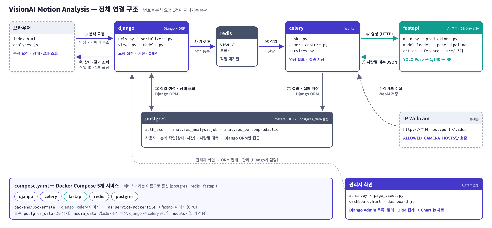
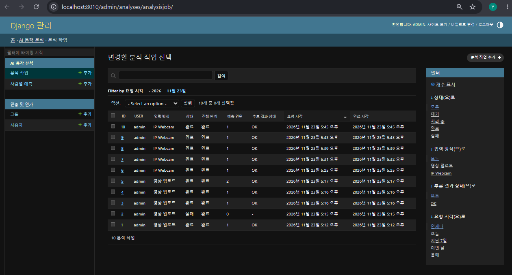
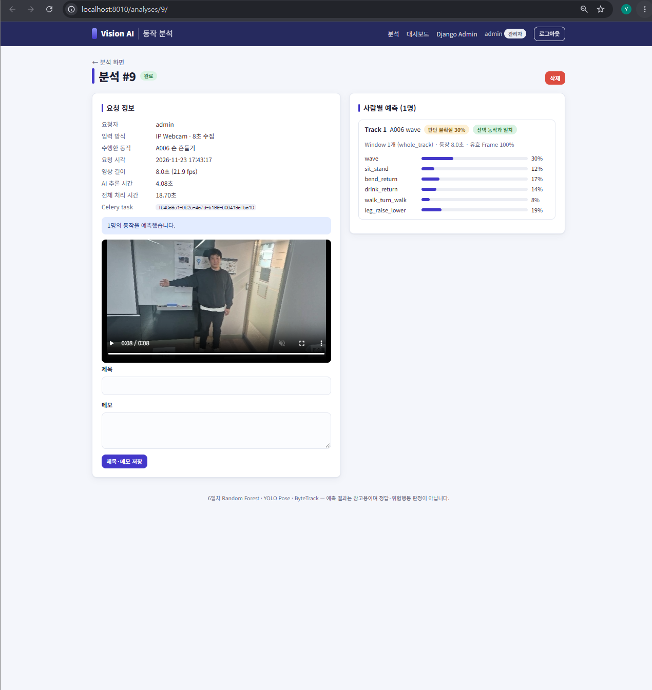
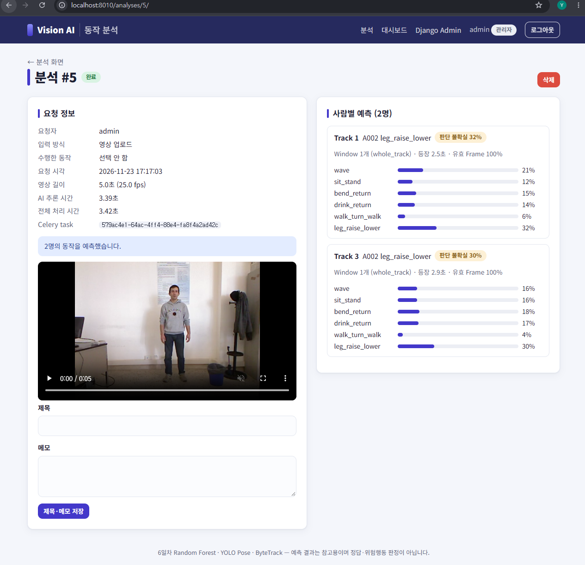

# VisionAI Motion Analysis

> 6일차에 학습한 **6개 동작 인식 Random Forest**를 재학습 없이 재사용한 Vision AI 웹 서비스
> Django · DRF · Celery · Redis · PostgreSQL · FastAPI · Docker Compose

      

---

## 1. 프로젝트 소개

회원이 **짧은 영상을 업로드**하거나 **휴대폰 IP Webcam으로 5~10초를 촬영**하면, 영상 속 **사람마다** 6개 동작 중 하나와 신뢰도를 예측해 보여 주는 서비스입니다. 분석은 Celery Worker가 백그라운드에서 처리하므로 사용자는 작업 ID를 즉시 받아 진행 단계를 확인하고, 결과는 PostgreSQL에 저장되어 관리자가 Django Admin과 대시보드에서 전체 기록과 입력 방식별 비교를 봅니다.

| A001 `bend_return` | A002 `leg_raise_lower` | A003 `walk_turn_walk` | A004 `drink_return` | A005 `sit_stand` | A006 `wave` |
|---|---|---|---|---|---|
| 허리 굽혔다 펴기 | 한쪽 다리 들었다 내리기 | 걷다가 방향 바꿔 걷기 | 음료 마신 뒤 돌아오기 | 앉았다 일어나기 | 손 흔들기 |

> 학습 데이터가 3명 × 6동작뿐이라 예측은 **정답이나 위험행동 판정이 아닙니다.** 모든 결과에 Confidence · Class별 확률 · 입력 품질을 함께 보여 주고, 0.55 미만은 **판단 불확실**로 표시합니다.

---

## 2. 실행 방법

**① 모델 준비** — `*.joblib`, `*.pt`는 용량 때문에 Git에서 제외합니다. 원본 실습에서 `ai_service/models/`로 복사하세요.

| 파일 | 원본 위치 |
|---|---|
| `rf_action_baseline.joblib` | `subject10_pose_action/artifacts/day06/` (`scripts/35_train_rf_baseline.py`가 저장) |
| `yolo11n-pose.pt` | `subject10_pose_action/` |
| `rf_feature_columns.json`, `rf_training_info.json` | 저장소에 포함됨 |

**② 실행**

```bash
cp .env.example .env                                           # POSTGRES_PASSWORD · DJANGO_SECRET_KEY · ALLOWED_CAMERA_HOSTS 수정
docker compose up --build -d                                   # 5개 서비스 실행 (fastapi healthy까지 약 1분)
docker compose exec django python manage.py migrate            # 마이그레이션 적용 (django 시작 시에도 자동 실행)
docker compose exec django python manage.py createsuperuser    # 관리자 계정 생성
docker compose ps                                              # 5개 모두 Up 확인
```

**③ 접속**

| 화면 | 주소 |
|---|---|
| 사용자 분석 화면 | http://localhost:8000/ |
| 관리자 대시보드 · Django Admin | http://localhost:8000/dashboard/ · http://localhost:8000/admin/ |
| FastAPI 문서 | http://localhost:8001/docs |

> 포트가 이미 사용 중이면 `.env`에서 `DJANGO_HOST_PORT`·`FASTAPI_HOST_PORT`만 바꾸면 됩니다(이 저장소의 시연 환경은 8010·8011). IP Webcam은 휴대폰과 PC를 같은 Wi-Fi에 두고 앱의 `IP:포트`를 `ALLOWED_CAMERA_HOSTS`에 등록합니다.
> Docker 없이 실행하기 · 테스트 실행 → [`docs/development.md`](docs/development.md)

---

## 3. 전체 아키텍처



| 서비스 | 책임 | 하지 않는 일 |
|---|---|---|
| **django** (Django + DRF) | 회원 · 분석 요청 접수 · 권한 · 조회 · 관리 화면 · ORM | AI 추론 |
| **celery** (Celery Worker) | 영상 확보(업로드 / 카메라 수집) → FastAPI 호출 → **Django ORM으로 결과 저장** | 화면 렌더링 |
| **fastapi** | YOLO Pose · ByteTrack → 1,140 Feature → Random Forest → JSON 반환 | **DB 접근** |
| **redis** | Celery 작업 대기열 | 영구 데이터 저장 |
| **postgres** | 사용자 · 분석 작업 · 사람별 예측 영구 저장 | — |

---

## 4. DB 설계 (ERD)


| 테이블 | 저장하는 것 | 작성 위치 |
|---|---|---|
| `auth_user` | 로그인 계정 (Django 기본 제공) | — |
| `analyses_analysisjob` | 분석 요청 1건과 진행 상태 · 오류 · 처리 시간 (영상은 MEDIA, DB에는 경로만) | `backend/analyses/models.py` → `AnalysisJob` |
| `analyses_personprediction` | 영상 속 사람별 예측. 2명이 나오면 작업 1건에 예측 2건 (`track_id`는 작업 안의 번호) | `backend/analyses/models.py` → `PersonPrediction` |

---

## 5. AI 분석 버튼 구현 흐름


Django는 작업을 DB에 저장하고 **커밋이 끝난 뒤** Celery에 등록한 다음 **작업 ID를 즉시 돌려줍니다(202)**. 무거운 영상 확보·추론·저장은 Worker가 백그라운드에서 처리하고, 브라우저는 작업 ID로 1초마다 상태를 조회합니다. 사용자는 추론이 끝날 때까지 요청을 붙들고 기다리지 않습니다.

---

## 6. 사용한 모델과 입력 형식

| 항목 | 내용 |
|---|---|
| 동작 분류 모델 | `rf_action_baseline.joblib` — 6일차 RandomForestClassifier, **재학습 없음** · 시작 시 3개 파일 교차 검증 |
| 모델 입력 | 1,140 = **30 Step × 38 Feature** (관절 17개 x·y 정규화 34 + 팔꿈치·무릎 각도 4) |
| Pose · 추적 | `yolo11n-pose.pt` + ByteTrack, 원본 `src/` 5개를 수정 없이 재사용 |
| 업로드 영상 | `.mp4 .avi .mov .mkv .webm`, 최대 200MB · 60초 |
| IP Webcam | 허용 목록의 카메라만, **5~10초(기본 8초)** 수집 → 30fps · 640px WebM 저장 → 업로드와 같은 추론 |
| FastAPI 입출력 | `POST /predict/video` (영상 파일) → 사람별 `track_id` · `action_id` · `confidence` · 확률 · 입력 품질 + 처리 시간 |

> 응답 형식과 오류 코드 → [`docs/api.md`](docs/api.md)

---

## 7. 실행 결과와 검증

| 정상 분석 | 오류 · 실패 |
|---|---|
|  |  |
| `walk_turn_walk.mp4` 업로드 → **A003 walk_turn_walk 66%**, AI 추론 7.2초 (Docker CPU) | 텍스트 파일을 `broken.mp4`로 업로드 → `FAILURE` · `[VIDEO_UNREADABLE] 영상을 열 수 없습니다` |

| 관리자 화면 (Django Admin) | 관리자 대시보드 |
|---|---|
|  |  |
| 작업 목록 · 상태/입력 방식 필터 · 사용자 검색 | 동작별 예측 건수 · 작업 상태별 건수 + 입력 방식 비교 (전체 사용자) |

<details>
<summary><b>추가 화면</b> — IP Webcam · 두 사람 · 입력 방식 비교</summary>

| IP Webcam | 두 사람 (Track 분리) | 입력 방식 비교 |
|---|---|---|
|  |  |  |
| 8초 수집 → wave 30% · 판단 불확실 · 선택 동작과 일치 | 한 작업에 Track 1 · 3 두 사람의 예측 | 업로드 vs IP Webcam: 신뢰도 · 일치율 · 처리 시간 |

</details>

### 기능 테스트

| 테스트 | 결과 | 증거 |
|---|---|---|
| T01 모델 불러오기 | ✅ 6 Class · 1,140 Feature · 교차 검증 | [`T01_model_load.txt`](reports/evidence/T01_model_load.txt) |
| T02 영상 업로드 | ✅ 원본 동작 영상 6/6 정답 | [`ab_window_strategy.md`](reports/evidence/ab_window_strategy.md) |
| T03 IP Webcam | ✅ 8초 수집 → wave 1순위 (3회 일관) | [`ab_capture_condition.md`](reports/evidence/ab_capture_condition.md) |
| T04 사람별 결과 | ✅ 2인 영상 → Track별 예측 분리 | [`01_sbu_shaking_hands.json`](reports/evidence/T02_T04/01_sbu_shaking_hands.json) |
| T05 · T06 비동기 · 영구 저장 | ✅ 즉시 202 + 작업 ID, 새로고침 후 유지 | 자동 테스트 |
| T07 CRUD 권한 | ✅ 다른 회원의 작업은 조회 · 수정 · 삭제 모두 404 | 자동 테스트 |
| T08 관리자 | ✅ staff만 대시보드 · 전체 기록 | 위 캡처 |
| T09 예외 처리 | ✅ 손상 파일 · 카메라 끊김 · AI 서버 장애 → FAILURE + 사유 | 위 캡처 · 자동 테스트 |
| T10 Docker | ✅ `docker compose restart` 후 작업 · 예측 유지 | [`T10_after_restart.txt`](reports/evidence/T10_after_restart.txt) |

자동 테스트 53개 (FastAPI 24 · Django 29) — [`docs/development.md`](docs/development.md)

### 더 보기

| 문서 | 내용 |
|---|---|
| [`docs/design_qa.md`](docs/design_qa.md) | 과제의 설계 질문 18개 답변 (joblib만으로 분류할 수 없는 이유, `classes_`, ORM 분리, 비동기 등) |
| [`docs/troubleshooting.md`](docs/troubleshooting.md) | 문제 해결 7건 — 학습·추론 입력 불일치, Docker 빌드, 브라우저 재생, 처리 시간 측정 등 |
| [`docs/api.md`](docs/api.md) | DRF · FastAPI API 계약과 오류 코드 |

**알려진 한계**: 학습 데이터가 3명뿐이라 새 사람 · 새 환경에서는 신뢰도가 낮습니다(IP Webcam 0.26~0.30). YOLO는 화면 밖 관절도 추정하므로 전신이 나오는 가로 구도를 권장합니다. Docker 구성은 개발용(`runserver`, CPU 추론)입니다.
