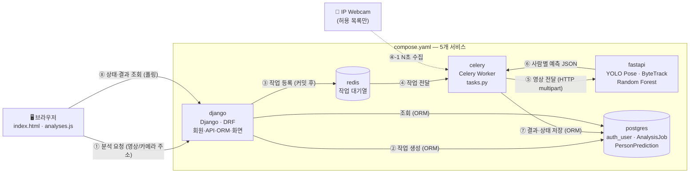
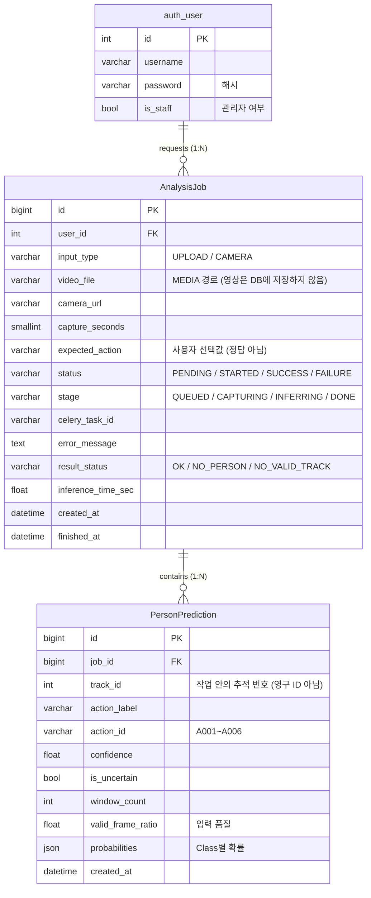
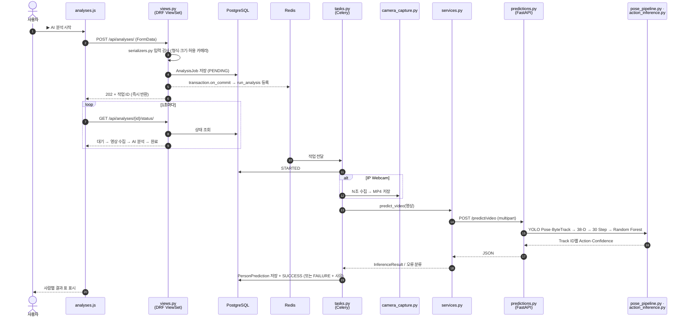
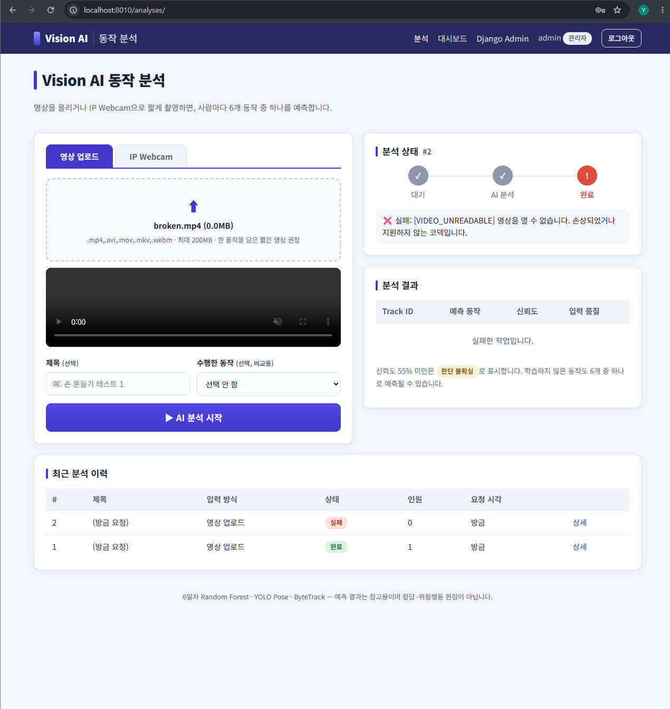

# VisionAI Motion Analysis

> 6일차에 학습한 **6개 동작 인식 Random Forest**를 재학습 없이 재사용해, 브라우저에서 영상 업로드 또는 IP Webcam으로 AI 분석을 요청하고 결과를 DB에 저장·조회하는 웹 서비스

      

---

## 1. 프로젝트 소개

회원이 **짧은 MP4를 업로드**하거나 **휴대폰 IP Webcam으로 5~10초를 촬영**하면, 영상 속 **사람마다(Track ID별)** 6개 동작 중 하나와 신뢰도를 예측해 보여 줍니다. 분석은 Celery Worker가 백그라운드에서 처리하므로 사용자는 작업 ID를 즉시 받고 진행 상태를 확인하며, 결과는 PostgreSQL에 저장되어 관리자가 Django Admin과 대시보드로 전체 기록을 봅니다.

| ID | Action | 의미 |
|---|---|---|
| A001 | `bend_return` | 허리를 굽혔다 펴기 |
| A002 | `leg_raise_lower` | 한쪽 다리를 들었다 내리기 |
| A003 | `walk_turn_walk` | 걷다가 방향을 바꿔 다시 걷기 |
| A004 | `drink_return` | 음료수를 마신 뒤 제자리로 돌아오기 |
| A005 | `sit_stand` | 앉았다 일어나기 |
| A006 | `wave` | 손 흔들기 |

> ⚠️ 학습 데이터가 3명 × 6동작뿐이므로 예측 Label은 **정답이나 위험행동 판정이 아닙니다.** 학습하지 않은 동작도 6개 중 하나로 예측될 수 있어, 모든 결과에 Confidence와 입력 품질(유효 Frame 비율)을 함께 표시하고 Confidence 55% 미만은 **판단 불확실**로 표시합니다.

---

## 2. 실행 방법

### 2-1. 모델 준비 (Git에 포함되지 않음)

`*.joblib`, `*.pt`는 용량 때문에 Git에서 제외합니다. 원본 실습 프로젝트에서 아래 위치로 복사하세요. JSON 2개는 저장소에 포함되어 있습니다.

| 파일 | 원본 위치 | 넣을 위치 |
|---|---|---|
| `rf_action_baseline.joblib` | `subject10_pose_action/artifacts/day06/` | `ai_service/models/` |
| `yolo11n-pose.pt` | `subject10_pose_action/` | `ai_service/models/` |
| `rf_feature_columns.json`, `rf_training_info.json` | `artifacts/day06/` | `ai_service/models/` (포함됨) |

### 2-2. Docker Compose로 전체 실행 (권장)

```bash
cp .env.example .env                  # POSTGRES_PASSWORD, DJANGO_SECRET_KEY, ALLOWED_CAMERA_HOSTS 수정
docker compose up --build -d          # django · celery · fastapi · redis · postgres
docker compose ps                     # 5개 모두 running(healthy) 확인
docker compose exec django python manage.py createsuperuser   # 관리자 계정 (마이그레이션은 django 시작 시 자동 적용)
```

| 화면 | 주소 |
|---|---|
| 사용자 분석 화면 | http://localhost:8000/ |
| 관리자 대시보드 | http://localhost:8000/dashboard/ (staff 계정) |
| Django Admin | http://localhost:8000/admin/ |
| DRF API | http://localhost:8000/api/analyses/ |
| FastAPI 문서 | http://localhost:8001/docs |

> Docker의 fastapi 컨테이너는 **CPU**로 추론합니다(이미지 크기 절약). `ai_service/Dockerfile`은 PyTorch CPU 전용 인덱스에서 `torch==2.15.0`을 받습니다. 빌드 중 이 단계가 실패하면 그 줄의 `--index-url ... torch==2.15.0 &&` 부분을 지우고 다시 빌드하세요(기본 GPU판이 설치되어 이미지가 커집니다).

### 2-3. Docker 없이 로컬 개발 실행 (WSL)

```bash
# ① DB·브로커만 Docker로
docker compose up -d postgres redis

# ② AI 추론 서버 (터미널 1)
cd ai_service && source .venv/bin/activate
uvicorn main:app --host 0.0.0.0 --port 8001

# ③ Django (터미널 2) — Python 3.12
cd backend
uv venv --python 3.12.14 --seed .venv && source .venv/bin/activate
uv pip install -r requirements.txt
python manage.py migrate && python manage.py createsuperuser
python manage.py runserver 0.0.0.0:8000

# ④ Celery Worker (터미널 3)
cd backend && source .venv/bin/activate
celery -A config worker --loglevel=INFO --concurrency=1
```

Redis·Worker 없이 빠르게 화면만 확인하려면 `.env`에 `CELERY_TASK_ALWAYS_EAGER=1`(요청 안에서 즉시 실행), `DB_ENGINE=sqlite`를 지정합니다.

### 2-4. 테스트

```bash
cd ai_service && python -m pytest                        # FastAPI·파이프라인 24개 (GPU·YOLO 불필요, 가짜 Pose 모델 사용)
cd backend && DB_ENGINE=sqlite python manage.py test      # Django 21개 (FastAPI·카메라는 가짜로 대체)
```

---

## 3. 전체 아키텍처



| 구성 요소 | 책임 | 하지 않는 일 |
|---|---|---|
| **Django + DRF** | 회원·CRUD·분석 요청 접수·조회·관리 화면·ORM | AI 추론, 모델 학습 |
| **Celery Worker** | 영상 확보(업로드 파일 / 카메라 수집) → FastAPI 호출 → **Django ORM으로 결과 저장** | 화면 렌더링 |
| **FastAPI** | 영상 → YOLO Pose·ByteTrack → 38-D Feature → 30 Step → Random Forest → JSON 반환 | **DB 접근·ORM·회원 관리** |
| **Redis** | Celery 메시지 브로커 | 영구 업무 데이터 저장 |
| **PostgreSQL** | 사용자·분석 작업·사람별 예측 영구 저장 | — |

업로드 영상은 `media_data` 볼륨에 저장되고 django·celery가 같은 경로로 공유합니다. FastAPI에는 파일 경로가 아니라 **영상 자체를 HTTP로 전송**하므로 컨테이너 간 `localhost` 가정이 없습니다.

---

## 4. DB 설계 (ERD)



- `auth_user`: Django 기본 제공 — 로그인 계정
- `AnalysisJob`: 분석 요청 1건과 진행 상태 — **`backend/analyses/models.py`**
- `PersonPrediction`: 영상 속 사람별 예측 — **`backend/analyses/models.py`**. 두 사람이 나온 영상이면 작업 1건에 예측 2건 (`UNIQUE(job, track_id)`)
- 삭제 정책: 완료·실패한 작업만 삭제 가능(진행 중이면 409). 삭제 시 사람별 예측은 CASCADE, 영상 파일도 함께 정리

---

## 5. AI 분석 버튼 구현 흐름



| 단계 | 대표 파일 |
|---|---|
| 버튼·폴링·결과 표시 | `backend/static/js/analyses.js`, `templates/analyses/index.html` |
| 요청 접수·작업 등록 | `backend/analyses/views.py`, `serializers.py` |
| 영상 확보·결과 저장 | `backend/analyses/tasks.py`, `camera_capture.py`, `services.py` |
| 추론 API | `ai_service/routers/predictions.py`, `main.py` |
| 추론 로직 | `ai_service/services/pose_pipeline.py`, `action_inference.py`, `model_loader.py` |

---

## 6. 사용한 모델과 입력 형식

| 항목 | 내용 |
|---|---|
| 동작 분류 모델 | `rf_action_baseline.joblib` — 6일차 RandomForestClassifier (scikit-learn 1.9.1), **재학습 없음** |
| 입력 규격 | `rf_feature_columns.json` — 1,140 = **30 Step × 38 Feature** (COCO 17 Keypoint x·y 정규화 34 + 팔꿈치·무릎 각도 4) |
| Pose 모델 | `yolo11n-pose.pt` + ByteTrack (Track ID별 분리) |
| 재사용 코드 | 원본 `src/` 5개를 수정 없이 복사: `pose_utils` · `feature_utils` · `sequence_utils` · `realtime_utils` · `multi_person_utils` |
| 업로드 형식 | `.mp4 .avi .mov .mkv .webm`, 최대 200MB, 최대 60초 |
| IP Webcam | 허용 목록(`ALLOWED_CAMERA_HOSTS`)의 카메라만, **5~10초(기본 8초)** 수집 후 업로드와 같은 추론 |
| 판단 불확실 기준 | Confidence < 0.55 (7일차 `confidence_threshold`) |

**FastAPI 입출력** — `POST /predict/video` (multipart `file`)

```json
{
  "status": "OK",
  "message": "2명의 동작을 예측했습니다.",
  "predictions": [
    {"track_id": 1, "action_id": "A006", "action_label": "wave", "confidence": 0.64, "is_uncertain": false,
     "window_mode": "whole_track", "window_count": 1, "valid_frame_ratio": 1.0, "duration_sec": 4.9,
     "probabilities": {"wave": 0.64, "...": 0.0}}
  ],
  "skipped_tracks": [],
  "video": {"fps": 30.0, "processed_frames": 150, "duration_sec": 5.0},
  "processing_time_sec": 1.6
}
```

| 응답 | 의미 | Worker 처리 |
|---|---|---|
| 200 `OK` | 사람별 예측 1건 이상 | SUCCESS + 예측 저장 |
| 200 `NO_PERSON` / `NO_VALID_TRACK` | 영상은 정상, 사람 없음 / 너무 짧게 보임 | SUCCESS (예측 0건 + 메시지) |
| 4xx `VIDEO_UNREADABLE` 등 | 입력 문제 | FAILURE + 사유 (재시도 안 함) |
| 503·연결 실패·타임아웃 | AI 서버 일시 장애 | 최대 3회 재시도 후 FAILURE |

**Window 전략** (`ai_service/project.json` → `window.strategy`, 기본 `auto`): 사람이 보인 시간이 12초 이하면 그 구간 전체를 30 Step으로 리샘플한 Window 1개(`whole_track`, 6일차 학습 방식), 더 길면 7일차 방식의 5초 Sliding Window를 확률 평균합니다. → 근거: [`reports/evidence/ab_window_strategy.md`](reports/evidence/ab_window_strategy.md)

---

## 7. 실행 결과와 검증

### 기능 테스트

| 테스트 | 내용 | 결과 | 증거 |
|---|---|---|---|
| T01 모델 불러오기 | 6 Class · 1,140 Feature · 3개 파일 교차 검증 | ✅ | `reports/evidence/T01_model_load.txt` |
| T02 영상 업로드 | 원본 day04 동작 영상 6개 → 6/6 정답 (whole_track) | ✅ | `reports/evidence/ab_window_strategy.md` |
| T03 IP Webcam | 허용 카메라 8초 수집 → 분석 | ⬜ | `reports/evidence/` 캡처 추가 |
| T04 사람별 결과 | SBU 2인 영상 → Track 1·2 분리 | ✅ | `reports/evidence/T02_T04/01_sbu_shaking_hands.json` |
| T05 비동기 처리 | 요청 즉시 202 + 작업 ID | ✅ | Django 테스트 `test_upload_creates_job_and_saves_predictions` |
| T06 영구 저장 | 새로고침 후에도 결과 유지 | ✅ | 〃 |
| T07 CRUD 권한 | 회원 B는 A의 작업 조회·수정·삭제 불가 (404) | ✅ | `test_user_cannot_touch_others_jobs` |
| T08 관리자 | staff만 대시보드, 차트 2개 + 선택 2개 | ✅ | `test_dashboard_staff_only` |
| T09 예외 처리 | 손상 파일·카메라 끊김·AI 서버 장애 → FAILURE + 사유 | ✅ | `test_corrupt_video_marks_failure` 외 |
| T10 Docker | 컨테이너 재시작 후 데이터 유지 | ⬜ | `docker compose restart` 후 캡처 |

### 실행 화면

| 정상 분석 | 오류·실패 | 관리자 대시보드 |
|---|---|---|
|  |  |  |
| 입력: (영상 이름) → 결과: (Track·동작·신뢰도) | 입력: 손상된 mp4 → `[VIDEO_UNREADABLE] 영상을 열 수 없습니다` | 동작별 예측 건수·작업 상태별 건수 |

### 문제 해결 기록 — Window 전략

- **문제**: walk_turn_walk(10.6초)가 drink_return(0.20)으로 오분류
- **확인**: 6일차 학습은 *Clip 전체*를 30 Step으로 리샘플, 추론은 7일차 방식의 *5초 Window 24개* 평균 → 각 Window에 동작 일부만 담김
- **변경**: `window.strategy` 설정 추가(`sliding` / `whole_track` / `auto`)
- **검증**: 같은 7개 영상 A/B → sliding 5/6 → whole_track **6/6** (walk_turn_walk 0.20 오답 → 0.66 정답, drink_return 0.48 → 0.63, wave 0.45 → 0.64)

### 알려진 한계

- 학습 데이터가 3명 × 6동작이라 새 사람·새 환경에서는 틀릴 수 있음 → 원인 탐색 순서: 입력 품질 → Pose → Feature → Window → 모델
- ByteTrack ID가 바뀌면 한 사람이 두 Track으로 나뉠 수 있음 (leg_raise_lower 영상에서 관찰)
- 검증에 사용한 day04 영상은 학습 원본일 가능성이 높아 정확도가 아니라 **이관 파이프라인 회귀 확인**의 의미

---

## 프로젝트 구조

```text
VisionAI_Motion_Analysis/
├── backend/                  Django·DRF·Celery (이미지 1개로 django·celery 실행)
│   ├── config/               settings·urls·celery
│   ├── accounts/             회원가입·로그인 (기본 User)
│   ├── analyses/             models·serializers·views(API)·page_views(화면·대시보드)·tasks·services·camera_capture·admin·tests
│   ├── templates/  static/   화면 (Chart.js는 static/vendor에 포함 — 오프라인 동작)
│   └── Dockerfile  requirements.txt
├── ai_service/               FastAPI 추론 서버
│   ├── main.py  routers/predictions.py
│   ├── services/             model_loader · pose_pipeline · action_inference
│   ├── src/                  원본 실습 코드 5개 (수정 없음)
│   ├── models/               joblib·pt (Git 제외) + JSON 2개
│   ├── project.json  tests/  Dockerfile  requirements.txt
├── reports/evidence/         T01~T10 증거
├── compose.yaml  .env.example  .gitignore
```
